# Benchmarks

Measurements of popso-sat against established open-source solvers. Every SAT answer in these
runs was checked against the formula by the benchmark runner
([benchmarks/run.py](benchmarks/run.py)); no run produced a wrong answer. Proofs were switched
off for the timing runs, except the v0.4.0 and v0.4.1 SAT Competition 2026 runs, where every
UNSAT answer of popso-sat was checked with its proof. Otherwise UNSAT proofs are verified separately by the correctness
gate ([benchmarks/gate.py](benchmarks/gate.py)) and the fuzzer. Tables from different machines
are never mixed.

## v0.4.1

New in 0.4.1, on by default:
- BVA during search;
- linear equations mod p solved by Gaussian elimination;
- congruence closure over XOR and ITE gates;
- vivification and sweeping changes;
- a walk that looks for models (`--walkmode=3`).

Also in 0.4.1, all with an unchanged search: faster propagation and inprocessing, lower memory,
and smaller, faster-checking proofs. See the [CHANGELOG](CHANGELOG.md).

### SAT Competition 2026 sample (AMD EPYC 4465P, Linux)

The same 168 instances as below (`sets/sc2026.txt`). Setup:
- 1000 s and 12 GB per instance;
- an AMD EPYC 4465P (12 cores, 24 threads, 62 GB);
- the three solvers ran at the same time, seven instances each (21 at once), so they shared the
  machine's load equally;
- every model checked;
- both popso-sat versions wrote proofs, and every UNSAT answer was verified by dpr-trim. 0.4.1
  had 65 and 0.4.0 had 63; the longest check took 1438 s;
- Kissat 4.0.4 (built from source) ran without a proof.

This is a faster machine than the i7 below, so its numbers are not comparable with that table.
The 0.4.1 defaults were chosen on this set (300 s runs), so it is not an independent test.

| | popso-sat 0.4.1 | popso-sat 0.4.0 | Kissat 4.0.4 |
|---|---|---|---|
| solved of 168 (SAT / UNSAT) | 108 (43 / 65) | 101 (38 / 63) | 82 (35 / 47) |
| solved within 300 s | 94 | 80 | 58 |
| PAR-2 (s) | 783.2 | 896.1 | 1131.7 |
| shifted geometric mean (s) | 114.2 | 155.6 | 320.7 |
| largest peak memory | 2.7 GB (T92) | 7.6 GB (cabp k290) | 2.4 GB (g2-T97) |

**What this shows:**
- 0.4.1 solves 11 instances that 0.4.0 does not, and loses 4.
  - Gained:
    - the four linear-equations instances, in 0.0 s (equations mod 3);
    - two school timetabling instances (UNSAT, 23 and 124 s; BVA during search);
    - xor_op_n40_d3 (UNSAT, 0.6 s; XOR substitution);
    - jkkk-one-one-11-38 (91 s), size_5_5_5 tensors (54 s), cabp k275 (256 s) and abw-K
      (26 s), all SAT.
  - Lost:
    - three satisfiable instances 0.4.0 solved late: ntil-90d-39 at 547 s, qwh.60 at 582 s,
      51-136961 at 731 s;
    - gensys-ukn004 (UNSAT, 809 s for 0.4.0).
- On the instances both versions solve, the shifted geometric mean drops on SAT (56 → 39 s) and
  barely moves on UNSAT (26.1 → 25.2 s). Overall, the commonly solved instances take 21% less
  time.
- Peak memory on the largest instances falls from 7.6 to 2.7 GB. The cyclic antibandwidth (cabp)
  instances drop from 5.8–7.6 GB to 1.0–1.5 GB.

**Against Kissat 4.0.4** (same machine, same limits, same time):
- 0.4.1 solves 37 instances that Kissat does not, and Kissat solves 11 that 0.4.1 does not.
- Most of the 37 come from techniques Kissat does not have:
  - counting certificates: chnl, count, exam scheduling, clique colouring, graph colouring,
    sudoku-php, relativized pigeonhole;
  - Gauss-Jordan elimination: lights-out, parity;
  - linear equations mod p;
  - XOR substitution.
- Kissat's 11:
  - SAT (5): knight_18, snw_16_9_preOpt_pre, ntil-90d-39, qwh.60, 51-136961;
  - UNSAT (6): minandmaxor128, asconhash H10, gensys-ukn004, satcoin-genesis, linvrinv5 and a
    booth/dadda multiplier miter.
- Instances both solve, shifted geometric mean: SAT 42 s (0.4.1) against 78 s (Kissat) on 30;
  UNSAT 57 against 69 s on 41.

## v0.4.0

New in 0.4.0, all on by default:
- counting certificates (pigeonhole, parity and counting formulas refuted before search, with
  PR proofs);
- Gauss-Jordan elimination on XOR constraints;
- shorter learned clauses (shrinking);
- focused-mode restarts at growing intervals;
- a larger BVA budget.

See the [CHANGELOG](CHANGELOG.md).

### SAT Competition 2026 sample (Intel i7-7700K, Linux)

The 168 instances of `sets/sc2026.txt`: a sample of the SAT Competition 2026 main track, one to
four instances per family. Setup:
- 1000 s and 12 GB per instance, four instances at a time;
- an Intel i7-7700K (4 cores, 8 threads, 64 GB), with no other benchmark jobs running;
- every model checked;
- 0.4.0 wrote its proofs, and each of its 61 UNSAT answers was verified by dpr-trim (the
  runner's `--proof --checker dpr-trim`; the longest check took 2983 s);
- 0.3.3 and Kissat 4.0.4 (the native binary, built from source) ran without proofs.

The 0.4.0 defaults were chosen on this set (300 s runs with each new technique on and off), so it
is no longer an independent test.

| | popso-sat 0.4.0 | popso-sat 0.3.3 | Kissat 4.0.4 |
|---|---|---|---|
| solved of 168 (SAT / UNSAT) | 98 (37 / 61) | 67 (35 / 32) | 80 (35 / 45) |
| solved within 300 s | 78 | 46 | 56 |
| PAR-2 (s) | 926.4 | 1303.8 | 1152.3 |
| shifted geometric mean (s) | 164.1 | 416.5 | 338.7 |

**What this shows:**
- 0.4.0 solves 35 instances that 0.3.3 does not, and loses 4. Of the 35:
  - 25 are refuted by counting certificates before search, in at most 2.5 s. The families are
    chnl, count, clique-coloring, clique formulas, coloring, graph colouring, exam scheduling,
    fpga routing, register allocation, sudoku-php and relativized pigeonhole. 0.3.3 solves
    none of them in 1000 s: resolution proofs of these formulas are exponentially long.
  - 7 are solved by Gauss-Jordan elimination:
    - lights-out: two satisfiable instances in 0.03 s, and two unsatisfiable ones refuted from
      their XORs before search;
    - par32-4 and par32-4-c (minimal disagreement parity): 25 s and 6 s;
    - two-trees-1023v (binary tree parity): 0.01 s.
  - 2 are solved by BVA:
    - or_randxor_k3_n600_m600, with the trial of 0.3.4;
    - rpoc_xits_09 (bioinformatics), in 10 s, with the larger budget: BVA now removes 104k
      clauses and adds 29k.
  - 1 more is satisfiable (a school timetabling instance, 438 s).
- All 27 counting refutations on this set also pass the competition's verified chain:
  dpr-trim -L, then cake_lpr.
- The 4 losses are satisfiable:
  - abw-K-dwt (antibandwidth): 300 s → not solved;
  - two cabp instances (cyclic antibandwidth): 258 and 951 s → not solved;
  - jkkk-one-one-11-38-sat (ensemble computation): 353 s → not solved.
- Satisfiable instances are slower on average: shifted geometric mean 79 → 90 s on the 31 that
  both solve.
  - The largest slowdowns: the hamiltonian x9 instances (58 → 212 s, 48 → 583 s), qwh.60
    (60 → 700 s) and a van der Waerden instance (31 → 350 s).
  - Some are faster: ntil-90d-37 528 → 129 s, QuasiGroup-4-12 642 → 285 s, sum-of-3-cubes
    115 → 6 s, and mod2-rand3bip (random XOR-SAT) 96 → 0.01 s with Gauss-Jordan.
  - Shrinking and the restart intervals change the search on these. The slowdowns are being
    investigated for 0.4.1.
- On the unsatisfiable instances that both solve, 0.4.0 is faster even though it writes a
  proof: 118 → 104 s, shifted geometric mean of 32.

**Against Kissat 4.0.4** (same machine, same limits):
- 0.4.0 solves 30 instances that Kissat does not, and Kissat solves 12 that 0.4.0 does not.
- Of the 30, 25 come from techniques Kissat does not have:
  - 20 counting refutations;
  - 5 Gauss-Jordan solutions (two lights-out refutations, par32-4, par32-4-c, two-trees-1023v).
  - The other 5 are hantzsche_wendt_unit_93, ntil-90d-39, QuasiGroup-4-12, StConn_7_128 and
    vdwb_k6_n300.
- Of Kissat's 12, 0.3.3 solved only two (cabp-V-nos6 k275 and jkkk-one-one-11-38-sat):
  - satisfiable (5): knight_18, snw_16_9_preOpt_pre, size_5_5_5_i116_r12 (tensors), cabp k275
    and jkkk;
  - unsatisfiable (7): three school timetabling instances (70-129 s for Kissat), minandmaxor128,
    asconhash, gensys-ukn004 and satcoin-genesis-UNSAT-7200.
  - With three seeds on the M4 (200-300 s), Kissat solves knight_18, jkkk and cabp k275 in two
    runs of three each. The 0.4.1 development build solves cabp k275 in three of three, and
    jkkk and knight_18 in none.
- On the 68 instances both solve, shifted geometric mean: satisfiable 67 s (0.4.0) vs 84 s
  (Kissat), unsatisfiable 63 s vs 82 s.
- Memory on the largest instances is 1.7-10x Kissat's: cabp-V-nos6 5.8-7.6 GB against 0.8 GB, T92
  3.2 against 1.8 GB. 0.4.1 caps the clauses elimination may add, which brings cabp k290 from
  3.5 to 1.4 GB on the M4 (300 s).
- Peak memory of runs that stayed under 434 MB (0.4.0) or 479 MB (Kissat) is not shown: the
  runner of these runs reported its own size as the floor (fixed in 0.4.1).

<details>
<summary>sc2026: solved per family where the two differ</summary>

| family (instances) | popso-sat 0.4.0 | popso-sat 0.3.3 |
|---|---|---|
| antibandwidth (1) | 0 | **1** |
| binary-tree-parity (1) | **1** | 0 |
| bioinformatics (1) | **1** | 0 |
| chnl (4) | **4** | 0 |
| clique-coloring (2) | **2** | 0 |
| clique-formulas (2) | **2** | 1 |
| coloring (2) | **1** | 0 |
| count (4) | **4** | 0 |
| cyclic-anti-bandwidth (4) | 1 | **3** |
| ensemble-computation (1) | 0 | **1** |
| exam-scheduling (4) | **4** | 0 |
| fpga-routing (3) | **3** | 1 |
| graph-coloring (4) | **4** | 1 |
| lights-out (4) | **4** | 0 |
| minimal-disagreement-parity (2) | **2** | 0 |
| or_randxor (1) | **1** | 0 |
| register-allocation (1) | **1** | 0 |
| relativized-pigeon-hole (1) | **1** | 0 |
| school-timetabling (4) | **1** | 0 |
| sudoku-php (2) | **2** | 0 |

67 of 87 families with equal solved counts not shown

</details>

<details>
<summary>sc2026: per-instance times (s); TL = not solved in 1000 s; bold = fastest</summary>


| solver | solved (SAT / UNSAT) of 168 | PAR-2 (s) | shifted geomean (s) |
|---|---|---|---|
| popso-sat 0.4.0 | 98 (37 / 61) | 926.4 | 164.08 |
| popso-sat 0.3.3 | 67 (35 / 32) | 1303.8 | 416.48 |

| instance | popso-sat 0.4.0 | popso-sat 0.3.3 |
|---|---|---|
| 81c36c1f55a6ee8e180f53f140ce05a3-01-integer-programming-20-30-40 | TL | TL |
| 2b35377a7b95f24449a3b607b61fff05-bench_1278.smt2 | 63.09 | **24.68** |
| 129162378e8ad29b5485a9c53feee4b7-hantzsche_wendt_unit_93 | 163.28 | **103.62** |
| a42230be4432b010789b6f97b090343c-soelberg_unit_223 | TL | TL |
| 4de5b7b3c8bf44b2e8c549128bc936a3-as-p141-l39-o0-rot-rfl-680-i.sanitized | TL | TL |
| 0d0fabe0fbca67a8740ebe8b8621d465-as-p147-l51-o0-rot-rfl-68-i.sanitized | TL | TL |
| 8d0d8518a438d93428257d9a38863c3c-as-p31-l12-o9-56.sanitized | 70.78 | **49.11** |
| ca18feb7d2bb6bee7a8ab28673fe1d62-as-p75-l27-o6-rot-4568.sanitized | TL | TL |
| d8225a58e2ca7c2fb93c533f406c02d5-abw-K-dwt__234.mtx-w50 | TL | **299.81** |
| b358bf7111086fd6d60b11c2f01465b8-crn_40_1521_s | TL | TL |
| 180e6d8b61fe6bab26126b78591e324e-baseballcover11with22_and2positions | **227.23** | 390.34 |
| b54b26f38d40a687b6277c49cf85de69-baseballcover11with25_and6positions | **625.05** | 671.61 |
| c8cde50f32ca3f78a4c74a173c63449b-bp5_CSO.normalised | TL | TL |
| 7db30d12cb06f0dc2f30abff80d96d6a-two-trees-1023v.sanitized | **0.01** | TL |
| c62a1855a4db8ae0b4bd625455332a4c-1x1x14_1x2x9_pair_2_2_0_3_2_1.sanitized | TL | TL |
| e5066e18b03451d92863160ed8166bdf-1x1x14_1x2x9_pair_2_4_0_3_1_0.sanitized | TL | TL |
| f604f43d1f5525f3dab4090190adbc66-1x1x14_1x2x9_pair_2_4_0_3_3_0.sanitized | TL | TL |
| 2c4491c50d4df86e7c1838083cedc703-1x1x14_1x2x9_pair_4_3_0_2_3_1.sanitized | TL | TL |
| a45aefde8bb26edb9634004146d0de89-Circuit_multiplier36 | TL | TL |
| 83ced7d9ee8058c52c9a68ded7fad0a5-p160_1 | TL | TL |
| 8390dca257561c53bf4eb6e158a2285f-mp1-klieber2017s-0490-024-t12 | 4.32 | **2.65** |
| 2fcd8533eba981967292f1b6e41f7433-simon-r20-0.sanitized | 0.00 | **0.00** |
| 7cbc3ce2052ba7c5b501f75af58ab3c4-simon-r22-1.sanitized | **0.01** | 0.01 |
| da34db9ea6b524f13708357f38432bb6-cabp-V-nos6.mtx.rnd-k274.sanitized | **506.32** | 620.01 |
| 9541d12f3e3d9201085c13f25145d2f7-cabp-V-nos6.mtx.rnd-k275.sanitized | TL | **258.28** |
| 5e1f1759de9bf931a8e26dbe7dd5b212-cabp-V-nos6.mtx.rnd-k290.sanitized | TL | **950.59** |
| 49644428681a87666a68fc9380dce072-cabp-X-can__715.mtx.rnd-k116.sanitized | TL | TL |
| 1f81f7e009f501014cb23a8c2d41836f-g2-ACG-20-10p1 | **761.41** | 828.54 |
| 9c5dd2eb0a40a150c686459a118c720a-1.xz.sanitized | **4.50** | 4.62 |
| fca71c20202ef404349136c3a00465eb-em_8_4_5_fbc | **266.56** | 347.10 |
| 5cae5c0629ce1c724746af890410cfc1-jkkk-one-one-11-38-sat | TL | **352.58** |
| 45a09efb026036ff4b8d19024a7563a9-fermat-931960058139995587 | TL | TL |
| 4ae685a11b5cecca76dc3d463481ce92-x9-10032.sat.sanitized | 212.02 | **57.60** |
| 7d311f620f4ebc4adf8f4079899750eb-x9-11033.sat.sanitized | 583.41 | **48.42** |
| 8117a2ac08e1acf52f660663efe2a5ca-170225812 | 0.93 | **0.93** |
| 4551c996fc6f5fbe62b43076abb25077-knight_18 | TL | TL |
| 01d6fa8efd18ebfecd06af408958477b-lightsout_sat_25_unbounded_direct_planted250_4_sat.sanitized | **0.01** | TL |
| 28dcc4119e1bbb5fbd3fdd8f4140f28d-lightsout_sat_25_unbounded_totalizer_planted150_3_sat.sanitized | **0.03** | TL |
| 8e1cdc28bad48753110be5bd578cb934-15.sanitized | TL | TL |
| 30c6fa5c4f5910029b782b712844c93a-6.sanitized | TL | TL |
| fed3f8d39738c2e935e8ed13ddeb6967-8.sanitized | TL | TL |
| e3a132ecb8108f7d8a46b6686e686b60-9.sanitized | TL | TL |
| 61fee64c8fc7f05b97a2bc14c0c2bf41-par32-4-c.shuffled | **6.22** | TL |
| 1eea3d913d346b900252d77fc0cb25c8-par32-4.shuffled | **24.68** | TL |
| 6d815089fb4095208754622b4c44a8f7-Carry_Bits_Fast_12.cnf | 8.41 | **4.79** |
| 09e0775d2b51c49ec1ec4d214ee7c8c8-ntil-90d-37.sanitized | **129.13** | 528.27 |
| 0e06895600b5cd0b6fadb87e17bf8145-ntil-90d-39.sanitized | 578.32 | **271.56** |
| 2d261a19d2754d92da3ddff04fda23c8-ntil-90d-44.sanitized | TL | TL |
| 46dc5e955b1fb541678d0634389353ac-ntil-90d-45.sanitized | TL | TL |
| 0922feab75c35d04d9b8df69013a6df0-toughsat_22bits_0 | 83.21 | **82.92** |
| 8da88a43b4ac226f614dd82d4519d8c6-toughsat_factoring_inf | TL | TL |
| ddf6fff9ebbbe9ec2a02f70b3316db6d-QuasiGroup-4-12_c18 | **285.18** | 641.80 |
| 543e67dd5abc272c37775b1b742a1d9a-qwh.60.1728.shuffled-as.sat03-1659 | 700.20 | **59.66** |
| 75429ff7acb5acb597abe01aa745c2a6-mod2-rand3bip-sat-250-3.shuffled-as.sat05-2220 | **0.00** | 95.99 |
| 5faba478cb08194407b5ec957ab08599-schooltt-5-7-11-2-4-1.4-2.6-0.8-0.9-seed2.sanitized | **437.93** | TL |
| 53d23b2b464a5c041114eb1f00cc4b81-puzzle32_sat | **96.35** | 224.10 |
| 8f5bca645bd8738eb74c2e1dc284774a-sgp_7-4-6.shuffled-as.sat05-2671 | TL | TL |
| 626c368587dd880086afc7b3fa1e6f27-snw_16_9_CCSpre | TL | TL |
| 67133027ab55906e3b757148ca7011dd-snw_16_9_Encpre | TL | TL |
| c15b09b9a7ceff4d4c8fe705958f92ba-snw_16_9_preOpt_pre | TL | TL |
| 5de866bc7ff4dfde3cd682b5aca75894-n320p5q2_n.af_239.sanitized | 3.91 | **3.08** |
| 91860f79f079fede859034c7d76a98a2-41-119494 | 52.45 | **17.37** |
| 510df610f94d5d57073a2c3b694dac4c-51-136961 | 812.75 | **742.70** |
| 6793abe982f9d5f9646f6657e13ecc39-55-140792 | TL | TL |
| b2047f327e213b5f14adb8c75ee514fb-60-135969 | TL | TL |
| 91e0db01b254eb78f6643328045bfeb9-sted5_0x1e3-20 | TL | TL |
| 9ef9243ff051b32795890fccd6c3f6b2-sum_of_3_cubes_50_bits_91 | **5.91** | 114.65 |
| 7fa502dfce37c37c1cafd50b3fba263f-SDP_104_15_107.sanitized | 38.15 | **19.55** |
| 1c0fe2ac410f3942e374ea72ec005d76-SDP_120_17_1675.sanitized | 924.52 | **644.42** |
| 515511be3905018ae7e6eb7ba7064d72-SDP_134_18_4334.sanitized | TL | TL |
| 654241eda3e1283f4b139192d1db055a-SDP_140_19_8786.sanitized | TL | TL |
| b438fa464c20a19fdb7788a3f0016f32-size_5_5_5_i116_r12 | TL | TL |
| ab17eed90e4da47767f72f518e3b4a26-vdwb_k6_n250.sanitized | **21.98** | 38.05 |
| 782b29d2d691fdc94e0ec5b899390e10-vdwb_k6_n300.sanitized | 350.07 | **31.02** |
| 43c298c756cac6d547a0457c2da7e468-xorshift_r14_31.sanitized | TL | TL |
| 231f3a169120d3cda9f8feea88a20d85-xorshift_r14_42.sanitized | TL | TL |
| ad5b80bb4d1b60bee12163df25846801-xorshift_r15_104.sanitized | TL | TL |
| d10b8bcd1bb5977c5ffe2d1859e4335f-xorshift_r15_175.sanitized | TL | TL |
| ac3e3bb744e258282990aa4307c08cb8-E00X23 | TL | TL |
| ae48df6541d190c096b1e5ba22d1b534-korf-17 | **234.76** | 287.91 |
| 123c397f55eeae78c45e8d973b8e9dce-rpoc_xits_09_UNSAT | **9.73** | TL |
| cc436db9fe0278663ce376e068069815-minandmaxor128 | TL | TL |
| bcdc894819cf050e57849fe84a1e8cc4-chnl-020x101.sanitized | **0.03** | TL |
| 757d64688ac60cba697a980dfbbf5075-chnl-030x091.sanitized | **0.05** | TL |
| 1fb646d2657b6dd5f0106dbec9fd6c27-chnl-040x041.sanitized | **0.04** | TL |
| 2027301e88cb029e4b47b747da8a180a-chnl-050x051.sanitized | **0.08** | TL |
| 5d06225b27017e9a703f10cb577cf3bf-clqcl_25_7_6.normalised | **1.05** | TL |
| 4aab4f954196d3277d9ca7b17c52acca-clqcl_25_8_7.normalised | **2.49** | TL |
| cb2e8b7fada420c5046f587ea754d052-clique_n2_k10.sanitized | **0.00** | 2.72 |
| 15456f0d13b26f0b4b21525ef7d0d711-clique_n5_k10.sanitized | **0.02** | TL |
| 1a3bef9e03bab1ed4e9e34506d72a451-le450_25b.col.25 | **0.04** | TL |
| 727ebce936c010888c7f71f00885e643-count_p2_M25.sanitized | **0.01** | TL |
| 35e0b5a19c88961d98dd806e805759f4-count_p2_M33.sanitized | **0.01** | TL |
| fbd9968f5067604694f11f14c07c5527-count_p2_M45.sanitized | **0.04** | TL |
| 0ec6bf97a96b9840ae84f1d1da4c4dcd-count_p3_M19.sanitized | **0.27** | TL |
| a957fdb07df865bb4fd24a00ceb49fdb-T90.2.0 | 559.36 | **473.03** |
| 59b585a33d30e6b7a476ed52a3f0384d-T92.2.0 | 614.31 | **509.27** |
| cc42cc7a8022820cbd0e98595126d07e-g2-T97.2.1 | TL | TL |
| a8dcaf436bda091dad9ca1ff58de7287-asconhashv12_opt64_H10_M2-BPHqhzNzqi_m5_6_U14.c | TL | TL |
| 4989239fbeb6eb40fc0b664d9ba92636-asconhashv12_opt64_H7_M2-K1zfAs8_m0_3_U5.c | **441.59** | 574.63 |
| 30e8b47741a4104c01eeea1d00bbce9e-aes_equiv_encry_3_rounds.debugged | **564.91** | 625.59 |
| 5553fec254b32349e0e48c7ee1e2d6c7-post-cbmc-aes-ee-r2 | **210.37** | 227.53 |
| 5ab5ac8d66c7e375037f12a536baf721-sbdp4_136_2.sanitized | TL | TL |
| e685a5d96e1ee9e051f191eca84b0d88-sbdp4_140_2.sanitized | TL | TL |
| 27495ba0093076d2e39a9b218e521ee2-sbdp4_61_2.sanitized | TL | TL |
| 211b0708454f7901054f5f92f525972e-sbdp4_65.sanitized | TL | TL |
| 8d2dfc50c1759dc11a6564d5c368c6df-FmlaImplyChain_3_7_8.sanitized | TL | TL |
| 5314fd6ccb53b6f6af49a594ea68a273-oski15a01b15s_opt | **274.36** | 279.38 |
| 12ac1c71ff0405cc150c2a2db6c4a255-exam_75_65.sanitized | **0.35** | TL |
| 7b9620b5d7da55bda43595fe37867acd-exam_90_80.sanitized | **0.78** | TL |
| 860788f93fb766e83e00a29de84180e7-mexam_17_15_2.sanitized | **0.01** | TL |
| 0d082b8fa36f662217bee5524cd24d3a-mexam_23_20_2.sanitized | **0.03** | TL |
| 1890f49a43a94b97828528b68c32b78e-homer11.shuffled | **0.00** | 2.31 |
| 3c4ac805726d78a869ff8116ee3533db-homer18.shuffled | **0.00** | TL |
| 805a742eb8b4e0df3561ca8e0670670b-homer20.shuffled | **0.00** | TL |
| d0b5d1dc96a5bf33d2c65106c3b179a8-connm-ue-csp-sat-n600-d0.04-s1793042357.used-as.sat04-975 | 24.50 | **23.29** |
| 8aa9ffb211d1cba850be2ee9d173b7e1-adv_gc_n300_k12_UNSAT_s42.sanitized | **0.01** | TL |
| ba7732774961fdf7508a998a41bd5366-factorize-1022117.sanitized | **18.22** | 21.56 |
| e5787bb4c8c29aa39b14a5e11387999d-fpsol2.i.2.29.sanitized | **0.07** | TL |
| 043c91001968a1fbd1ef419540fcb396-miles1500.72.sanitized | **0.49** | TL |
| c261941bfec8b89d75fee1a66a839169-manthey_single-ordered-initialized-w48-b9 | **655.49** | 893.46 |
| 08cf53ca00dce11f5bfc02121c9bcd33-GreenTao_2-3-5_528 | **151.14** | 183.04 |
| 40ae60a61929b6bfa2ac99ab4b9a0f7e-grs-96-192 | TL | TL |
| 3005623c4df6f5056a41a26d0f173e70-DLTM_twitter634_77_13 | TL | TL |
| 7a13ffe9546cc7dfabdedebb64700e8a-w19-20.0 | **132.35** | 168.97 |
| 0efcbd10294eb001b16b4d126923372f-lightsout_sat_23_unbounded_direct_random50_2_unsat.sanitized | **0.01** | TL |
| 32e344a5ab3af245f982678d2b751c6d-lightsout_sat_24_unbounded_totalizer_corner_0_unsat.sanitized | **0.02** | TL |
| 29a27e97790bda6c34808f631dd0418e-linvrinv5.shuffled-as.sat05-564 | TL | TL |
| e55a49d8065d65650f24c0f3ecef30b6-af-synthesis_stb_50_120_4_unsat | **438.57** | 648.31 |
| a80a252b748882980d9a80ddea8c5cff-bdmdm_28_1.sanitized | TL | TL |
| 5f81a94799858590a2bc96db917bf894-bdobwm_28_54.sanitized | TL | TL |
| 7ac164a9d153f0a2d9bf54a98d429636-bwoawm_28_5.sanitized | TL | TL |
| 6ad453d6174581d982c4e75e37a38d79-dobdm_14_1.sanitized | TL | TL |
| de8c42d50f1dbf43a731f1916dc6bf01-16_16_booth_dadda_mapped_and_and_wallace_origin_bit28 | TL | TL |
| fac2035ba83ac2d0c2d67509d3f82b94-16_16_booth_dadda_origin_and_default_mapped_ultra_bit29 | 889.56 | **837.92** |
| 0be1e12a8e7282d1a4e389bb90f6dbc7-or_randxor_k3_n600_m600 | **19.20** | TL |
| 22c8d6aa86d51e15ef5ab37479eda22b-xor_op_n40_d3 | TL | TL |
| 011984fd82d62d609e776fbf5de75440-arles_thres20_p10_r7533 | 0.01 | **0.01** |
| dd5d530ac8bf0019412d023488b075eb-arles_thres20_p20_r4109 | 0.01 | **0.01** |
| 62060247cd0ad566a828c30571c2c774-marijn-philips | **218.88** | 257.74 |
| 6add7e416c1126607afeb2666af330ac-constraints_16_0.5_1.sanitized | **119.73** | 195.85 |
| f8443057c188f6c9cfb711ff3d4aa6ff-constraints_17_0.5_2.sanitized | **79.94** | 92.90 |
| 284dec9d0d0404c8b80d8bd8064e4c68-gensys-ukn004.shuffled-as.sat05-3844 | TL | TL |
| dc7817dfa2817916b266c1cfacd2ee66-constraints_25_4_5_12_12_0_0_0.sanitized | **241.69** | 248.80 |
| 965ca988015c9aee5a1a7b2136c1fe5d-os_fwalk_12 | **0.00** | TL |
| e430acf720b63044e5c825a00a76b0eb-rphp_p25_r25 | **0.02** | TL |
| 4e64ffc14db014d5591f40865376c32a-satcoin-genesis-UNSAT-7200 | TL | TL |
| 48432767076e402d2accbf2da7260885-schooltt-5-3-8-2-4-5-10-0.1-0.2-seed2.sanitized | TL | TL |
| 47173e8ab499159d3aa301b0101fe170-schooltt-5-3-9-2-4-5-10-0.1-0.1-seed3.sanitized | TL | TL |
| ad2247443454da1fbd4543dd1fa5b57c-schooltt-5-3-9-2-4-5-10-0.1-0.2-seed3.sanitized | TL | TL |
| 5ee05ef0bcb42cb12bd698978c05178c-mp1-bsat201-707 | **355.22** | 644.47 |
| 337ee3de87f824f99508e65faa6e1a0b-SocialGolfers-6-6-7-cp_c18 | TL | TL |
| 878bcc11e1e243680f7946bcf428f465-linked_list_swap_contents_safety_unwind45 | 74.60 | **58.05** |
| bfc825d1eb0670fd90805c546fea5c6b-snw_17_9_CCSpreOptEncpre | TL | TL |
| b3c587501567db72e6e66c6930cf15ed-StConn_7_128.sanitized | 470.11 | **316.51** |
| bf8c8761003704e761ce36db6665f741-scc_6087_19_0.3_0.1_20.af_130.sanitized | **8.06** | 14.86 |
| c557ad9cb79983b9d429c219e3cecbb8-scc_7216_12_0.5_0.2_11.af_463.sanitized | **5.75** | 8.36 |
| f2c6d035d0aa58cc06927af6be7a821f-scc_9630_26_0.3_0.1_17.af_516.sanitized | **24.97** | 41.51 |
| 5f65b4cceeb01c56e037df144309b29e-SGI_30_70_21_70_7-log.shuffled-as.sat03-153 | TL | TL |
| 3598c10125496ad7218852effc5c711f-SGI_30_70_22_70_7-dir.shuffled-as.sat03-154 | TL | TL |
| 7fe153ced2c966dcdeb42b6714b4d6b7-sudoku-N30-11 | TL | TL |
| 43d40ced32b5be08814ef24f97379654-php_sudoku_p15_h14.sanitized | **0.00** | TL |
| f83424f869b61931d720f93e5a12df3c-php_sudoku_p20_h19.sanitized | **0.01** | TL |
| 82cad197a0b7919f1f51ec51f7267e6f-ex095_8 | TL | TL |
| bd0b055b890a9ace598a0c4aba40de30-sat-bench-trig-bhaskara | **538.57** | 615.77 |
| 262a226a47330987f038128579967405-ais8.cnf.mis-97.debugged | **10.05** | 10.20 |
| 66204949278cdd9d81e102eace6d4669-vdw_4_7_n109.sanitized | **174.36** | 215.45 |
| a20f076f7fce54172e823c63ea7948f7-vdwb_k5_n260.sanitized | **23.82** | 27.21 |

</details>

### Small sets (Apple M4 Pro, macOS)

The small sets of the earlier sections, 120 s. The machine was shared with another project
this time, so 0.4.0 and 0.3.4 ran as pairs, one instance at a time, back to back (the order
alternating), so that both see the same load. Kissat's times for these sets are in the v0.3.4
section (an idle machine).

| set | popso-sat 0.4.0 | popso-sat 0.3.4 |
|---|---|---|
| unsat26 (26 unsatisfiable) | 22 / 57.2 | 22 / 55.2 |
| tune (29 mixed) | 25 / 47.4 | 25 / 45.7 |
| validation (32 held out) | 21 / 103.7 | 20 / 109.9 |
| medium (25 generated, 60 s, two at a time) | 25 / 2.7 | 25 / 3.7 (v0.3.4 section) |

(solved / PAR-2 in seconds.)

**What this shows:**
- These sets have few of the structures that 0.4.0 refutes or solves directly, so the totals
  barely move: the gains come from Gauss-Jordan and the new search defaults, case by case.
  - urquhart3_25bis (Tseitin formulas): 4.1 s → 0.01 s, refuted from its XORs before search.
  - mdp-28-10-sat: not solved in 120 s → 0.03 s, and mdp-28-12-sat 7.5 → 0.03 s (the detached
    Gauss-Jordan solver).
  - ps_200_323_70, case9, ncc_none_3001, sqrt_ineq_3, SC23_Timetable: not solved → solved.
  - brent_51 32.8 → 2.3 s, mp1-squ_ali abix 45.5 → 7.6 s.
- Losses:
  - spg_420_280 (9 s → not solved within 120 s): learned clause shrinking and the restart interval
    change its search (1.45M conflicts instead of 116k); being investigated for 0.4.1.
  - stb_588_138 DS-ST (15 s → not solved) and mp1-squ_ali abio (21 s → not solved): satisfiable
    instances whose times vary a lot from run to run (stb DS-ST: 35–90 s with any change of
    the search).
  - frb45-21-2 (27 s → not solved), satisfiable.

<details>
<summary>unsat26: per-instance times (s); TL = not solved in 120 s; bold = fastest</summary>


| solver | solved (SAT / UNSAT) of 26 | PAR-2 (s) | shifted geomean (s) |
|---|---|---|---|
| popso-sat 0.4.0 | 22 (0 / 22) | 57.2 | 23.11 |
| popso-sat 0.3.4 | 22 (0 / 22) | 55.2 | 21.43 |

| instance | popso-sat 0.4.0 | popso-sat 0.3.4 |
|---|---|---|
| c1b30b4e03c3024ad9d084e29e79aa46-BubbleVsPancakeSort_6_6 | 19.55 | **19.28** |
| 004b0f451f7d96f6a572e9e76360f51a-spg_420_280 | TL | **9.03** |
| bb80971144a5423532aea9424dade891-div-mitern174 | **14.05** | 14.60 |
| 5e04f38ff11cee5d75fb98e12f6a14fc-sqrt-mitern172 | 29.97 | **23.77** |
| a1158a2d8c8a1c6da02c2c4fcb32337f-6s158_Iter2 | **4.05** | 4.44 |
| 01d142c43f3ce9a8c5ef7a1ecdbb6cba-urquhart3_25bis.shuffled | **0.01** | 4.07 |
| 3ff114cc7bee4f39fa56a0325e605c2d-stb_588_138.apx_2_DC-ST | **74.04** | 86.82 |
| 112b0ac22b2a567cd3badfed3a5497fd-mchess16-mixed-35percent-blocked | 29.91 | **19.97** |
| 8d458780fb74c28c01a5fe89990ad521-mchess16-mixed-45percent-blocked | 8.29 | **8.05** |
| 44092fcc83a5cba81419e82cfd18602c-php-010-009.shuffled-as.sat05-1185 | **0.01** | 1.70 |
| 02066c116dbacc40ec5cca2067db26c0-mrpp_4x4_12_12 | 6.30 | **4.34** |
| 26114429758a203d651f4df87c94de4c-sgen1-unsat-97-100.cnf.mis-72.debugged | 10.91 | **8.51** |
| d88c6afc13cdad0e2c8371a879692b39-battleship-13-13-unsat | 4.69 | **4.63** |
| ad9eb96bac59319fc2f7daffd1f961f8-AProVE07-21 | 1.52 | **0.83** |
| 02627689047d06fbb642eef14768d751-ps_200_300_70 | TL | TL |
| 5d357f1e4b5abc96c90d305f629edd5c-ps_200_323_70 | **74.37** | TL |
| fe800e62b55609cb152965c223e72280-div-mitern171 | **53.18** | 60.76 |
| 07b7859003d84402cbb1ebdc37655d55-6s186_Iter20 | **107.23** | 110.26 |
| a130a3f95891daed1bfd71c77bd2d8a1-SAT_dat.k80 | **29.69** | 31.34 |
| 436d00b6d41912e800e9855d08c75139-manol-pipe-f7nidw | **33.23** | 36.40 |
| 81b674a2aa6fbda9b06cf8ea334ddc44-beempgsol2b1 | **4.35** | 4.44 |
| 4282ea42fd414bfd2c4bf81fe8a43e24-DivU_1520_10.cnf.sanitized | **6.30** | 6.39 |
| da43a3ef0ef5d34143e765d480dedc7a-DivU_624_11.cnf.sanitized | 7.65 | **6.73** |
| fae08ac5b6d7eeb4f56f1cfac6c51703-j3045_4_mdd_bm1 | TL | TL |
| dafc03ea784fee849febca7b64230558-pcmax-scheduling-m30-14113-167638-UNSAT.sanitized | TL | TL |
| d672bdbca3b1fb26d585e78add79537e-velev-pipe-o-uns-1.1-6 | **8.47** | 9.08 |

</details>

<details>
<summary>tune: per-instance times (s)</summary>


| solver | solved (SAT / UNSAT) of 29 | PAR-2 (s) | shifted geomean (s) |
|---|---|---|---|
| popso-sat 0.4.0 | 25 (12 / 13) | 47.4 | 16.65 |
| popso-sat 0.3.4 | 25 (11 / 14) | 45.7 | 16.73 |

| instance | popso-sat 0.4.0 | popso-sat 0.3.4 |
|---|---|---|
| 02223564bd2f5c20768e63cf28c785e3-mp1-squ_ali_s10x10_c39_abio_SAT | TL | **20.67** |
| 6965d5369d3ab26daaf074303c3d1739-mp1-squ_ali_s10x10_c39_abix_SAT | **7.58** | 45.47 |
| e01c39b7b41c9ff1621579b747254fab-ncc_none_3001_7_3_3_1_31_435991723 | **38.04** | TL |
| fb5cf4ad3c46dd294eb8253218524ba6-cfi-rigid-r2-0072-01-or_3 | **5.94** | 9.85 |
| cfa14a7015b0f7fecd98e898f3c95896-velev-vliw-sat-4.0-b8 | 15.22 | **12.31** |
| 5457c05649be6f3bc4f743c5e6086a18-mdp-28-10-sat | **0.03** | TL |
| cd36b290c27ed9bafedfb2ca88469f01-mdp-28-12-sat | **0.03** | 7.54 |
| 29bab0de14e56e526be9683131005cb2-stb_588_138.apx_2_DS-ST | TL | **15.36** |
| 74931e82fd208ed949fa44bccd80df6b-DivS_862_11.cnf.sanitized | 1.54 | **0.79** |
| accf33a84bdf211bebbd2111fb7f6b91-DivS_942_11.cnf.sanitized | 1.62 | **0.86** |
| 7083b70c1976162e2693d7a493717ffd-battleship-14-26-sat | 1.57 | **0.43** |
| 9276ce38c625b2d00de247f8588f1542-combined-crypto1-wff-seed-102-wffvars-500-cryptocplx-31-overlap-2 | 42.65 | **13.40** |
| 04e219c640ed59dc68ea2d50493de5b5-mp1-Nb5T15 | **13.28** | 32.56 |
| 416e33a8463911546e4cd87d282a7e1e-case10 | TL | TL |
| fab2022deb130fe3ad1136a5c71b4109-case9 | **87.14** | TL |
| c1b30b4e03c3024ad9d084e29e79aa46-BubbleVsPancakeSort_6_6 | 19.73 | **19.03** |
| 004b0f451f7d96f6a572e9e76360f51a-spg_420_280 | TL | **9.18** |
| bb80971144a5423532aea9424dade891-div-mitern174 | **14.05** | 14.43 |
| 5e04f38ff11cee5d75fb98e12f6a14fc-sqrt-mitern172 | 29.31 | **23.40** |
| a1158a2d8c8a1c6da02c2c4fcb32337f-6s158_Iter2 | **4.02** | 4.35 |
| 01d142c43f3ce9a8c5ef7a1ecdbb6cba-urquhart3_25bis.shuffled | **0.01** | 3.99 |
| 3ff114cc7bee4f39fa56a0325e605c2d-stb_588_138.apx_2_DC-ST | **72.32** | 86.19 |
| 112b0ac22b2a567cd3badfed3a5497fd-mchess16-mixed-35percent-blocked | 29.15 | **18.72** |
| 8d458780fb74c28c01a5fe89990ad521-mchess16-mixed-45percent-blocked | **7.56** | 7.57 |
| 44092fcc83a5cba81419e82cfd18602c-php-010-009.shuffled-as.sat05-1185 | **0.01** | 1.63 |
| 02066c116dbacc40ec5cca2067db26c0-mrpp_4x4_12_12 | 5.94 | **4.02** |
| 26114429758a203d651f4df87c94de4c-sgen1-unsat-97-100.cnf.mis-72.debugged | 10.58 | **8.35** |
| d88c6afc13cdad0e2c8371a879692b39-battleship-13-13-unsat | 4.58 | **4.52** |
| ad9eb96bac59319fc2f7daffd1f961f8-AProVE07-21 | 1.50 | **0.81** |

</details>

<details>
<summary>validation: per-instance times (s)</summary>


| solver | solved (SAT / UNSAT) of 32 | PAR-2 (s) | shifted geomean (s) |
|---|---|---|---|
| popso-sat 0.4.0 | 21 (11 / 10) | 103.7 | 43.01 |
| popso-sat 0.3.4 | 20 (10 / 10) | 109.9 | 47.13 |

| instance | popso-sat 0.4.0 | popso-sat 0.3.4 |
|---|---|---|
| 47f5872181a581dff34eb33123fe3242-b17 | 8.89 | **8.45** |
| 705f6075b27775e03daf6e8d781cb953-shift1add.28943 | 9.17 | **8.39** |
| 30e680ded3b9be6be0b5baac273f2646-asconhashv12_opt64_H5_M2-A8qZX_m0_3_U23.c | TL | TL |
| 036b541db9d0839b0591d408ff4f77ae-aes_decry_2_rounds.debugged | **97.90** | 112.58 |
| a7aac5c83f236fd8b3de3275e3f5499d-edit_distance041_183 | 68.58 | **43.97** |
| d6402b482a5dc102a5b09360689e2be8-jkkk-one-one-11-32-unsat | TL | TL |
| d5928883c1e1f70764a31a83aa419eaf-oski15a01b42s_opt | TL | TL |
| 43687a48fb119ca61b47c2fc69a71e7d-manthey_single-ordered-initialized-w42-b8 | **56.23** | 62.13 |
| 20cae5fe475d571da703f89d5da4bb8f-grs-96-32 | 65.34 | **53.48** |
| 0dc468413b65339fad7e4f981bf2fb1e-reconf20_61_myciel4_2 | 13.60 | **12.11** |
| 4513c58c16e72a34f9f8518db7baeb9e-ktf_TF-3.tf_3_0.02_24 | 86.23 | **74.34** |
| e12874b16df577b301608d03731595d8-rphp5_085_shuffled | TL | TL |
| 6f0e236c999de0a5e3c46fd3463b1d0d-rook-56-1-1 | TL | TL |
| 920bbe559da4ea37fd636605316a791c-SCPC-500-19 | **10.57** | 12.50 |
| 65138afdf7eb054be5131f2b0de84369-satch2ways12u | **7.44** | 12.40 |
| 61069e0e3339af80000b774a041b7d96-constraints_18_0.3_2.sanitized | TL | TL |
| 96e01064ac3b644143278c21859e201f-brent_51_0.29 | **2.30** | 32.77 |
| f02379d63678798e38dcc52b043cc51d-asconhashv12_opt64_H13_M2-axxJh7DAq767y_m4_5.c | TL | TL |
| 0ae917c2e0c1d39cbe411c29b2f5ff08-dislog_a14_x14_n24 | TL | TL |
| 72c0d81e16d91bcaed808efcde2e5069-Folkman-175-1251868.sanitized | **39.92** | 52.20 |
| 0a27eb7c16c1e69ff4d087d217ac89cb-noL-11-0.sanitized | 4.78 | **3.25** |
| f32bb347996c351bc3e9a91c58e8601d-DLTM_twitter774_83_17 | TL | TL |
| 7acf6cf25ddaf2ab98106e0bb3b9ddb1-af-synthesis_stb_50_140_3_sat | 23.90 | **19.66** |
| 0336f81b60baac5b8f481dd3c32861a5-mod4block_2vars_10gates_u2_autoenc-sc2009 | **12.32** | 25.40 |
| ddd3b43476c18cf483aac233d4dc1c68-PRP_20_40 | **18.01** | 24.77 |
| c2bfe541b7cff948fa3193e9ca0eddee-frb45-21-2.used-as.sat04-884 | TL | **26.62** |
| e99e266b422513a2898c13898a1de501-rbsat-v760c43649gyes9 | 39.24 | **30.93** |
| b5cede38496a803dcfa155a5f4295c47-SC23_Timetable_C_476_E_50_Cl_32_D_6_T_50 | **74.75** | TL |
| a811388cc92def6ef2d639dc062d456c-ContextModel_output_6_3_8.bul_.dimacs | TL | TL |
| b51583e32432c5778c7e3e996c3bfeba-sqrt_ineq_3.c | **7.73** | TL |
| 608941b989227d93c62b3a9b4280011b-summle_X8639_steps8_I1-2-2-4-4-8-25-100 | 28.26 | **13.66** |
| 86173292a2c6a506acf27a81db853bb5-ktf_TF-7.tf_3_0.06_113 | **2.41** | 6.17 |

</details>

## v0.3.4 (Apple M4 Pro, macOS)

Same machine and setup as the v0.3.3 section below (120 s, two instances at a time, native
Kissat 4.0.4, every model checked). New in 0.3.4: bounded variable addition (BVA) is on by
default, behind a trial. The trial runs BVA's matching without changing the formula, and the
replacements are made only if they would remove at least a fifth of the clauses. When the
trial declines, the search is exactly that of 0.3.3. See the [CHANGELOG](CHANGELOG.md).

| set | popso-sat 0.3.4 | popso-sat 0.3.3 | Kissat 4.0.4 |
|---|---|---|---|
| unsat26 (26 unsatisfiable) | 22 / 56.2 | 21 / 63.3 | 22 / 52.9 |
| tune (29 mixed) | 25 / 47.3 | 23 / 61.6 | 26 / 45.5 |
| validation (32 held out) | 21 / 104.6 (identical to 0.3.3, see below) | 21 / 104.6 | 24 / 83.9 |
| sc2026, the 16 instances where the trial passes (300 s) | 8 / 319.0 | 4 / 457.7 | |

(solved / PAR-2 in seconds.)

**What this shows:**
- BVA helps where it removes a large part of the formula: at-most-one cliques in battleship,
  stb argumentation and pigeonhole-like counting.
  - battleship-13-13: not solved in 120 s → 4.8 s.
  - stb_588_138 DS-ST: not solved → 16 s.
  - battleship-14-26: 4.5 → 0.5 s.
- On the held-out sample of the SAT Competition 2026 (`sets/sc2026.txt`), 16 of 168
  instances pass the trial. Within 300 s, four more of them are solved: homer18, homer20,
  os_fwalk_12 and or_randxor_k3_n600_m600. homer11 is slower (1.4 → 20 s).
- None of the 32 validation instances passes the trial, so 0.3.4 searches them exactly as
  0.3.3 does. Conflict, decision and propagation counts are identical on the instances
  checked.
- The validation rerun took place while other jobs used the machine. All its times were
  20–25% longer: 20 solved, PAR-2 111.0 s, with oski15a01b42s at 109 s in 0.3.3 just over
  the limit. The table therefore shows 0.3.3's idle-machine times.
- The same load explains velev-vliw-sat in the tuning set (11.7 → 15.5 s, identical search).
- The full sc2026 tables (168 instances, 1000 s, Linux) follow with the next release.

<details>
<summary>unsat26: per-instance times (s); TL = not solved in 120 s; bold = fastest</summary>


| solver | solved (SAT / UNSAT) of 26 | PAR-2 (s) | shifted geomean (s) |
|---|---|---|---|
| popso-sat 0.3.4 | 22 (0 / 22) | 56.2 | 22.15 |
| popso-sat 0.3.3 | 21 (0 / 21) | 63.3 | 23.27 |
| Kissat 4.0.4 | 22 (0 / 22) | 52.9 | 20.72 |

| instance | popso-sat 0.3.4 | popso-sat 0.3.3 | Kissat 4.0.4 |
|---|---|---|---|
| c1b30b4e03c3024ad9d084e29e79aa46-BubbleVsPancakeSort_6_6 | 19.83 | **18.41** | 19.05 |
| 004b0f451f7d96f6a572e9e76360f51a-spg_420_280 | 9.59 | **8.52** | 65.99 |
| bb80971144a5423532aea9424dade891-div-mitern174 | 15.05 | **14.06** | 14.37 |
| 5e04f38ff11cee5d75fb98e12f6a14fc-sqrt-mitern172 | 27.18 | **22.57** | 23.19 |
| a1158a2d8c8a1c6da02c2c4fcb32337f-6s158_Iter2 | 4.74 | 4.24 | **1.83** |
| 01d142c43f3ce9a8c5ef7a1ecdbb6cba-urquhart3_25bis.shuffled | 4.52 | 3.93 | **0.27** |
| 3ff114cc7bee4f39fa56a0325e605c2d-stb_588_138.apx_2_DC-ST | 100.97 | 91.95 | **77.08** |
| 112b0ac22b2a567cd3badfed3a5497fd-mchess16-mixed-35percent-blocked | 22.06 | **17.90** | 27.76 |
| 8d458780fb74c28c01a5fe89990ad521-mchess16-mixed-45percent-blocked | 8.49 | 7.43 | **2.45** |
| 44092fcc83a5cba81419e82cfd18602c-php-010-009.shuffled-as.sat05-1185 | 1.73 | 1.86 | **1.32** |
| 02066c116dbacc40ec5cca2067db26c0-mrpp_4x4_12_12 | 4.65 | **3.91** | 4.09 |
| 26114429758a203d651f4df87c94de4c-sgen1-unsat-97-100.cnf.mis-72.debugged | 9.33 | 8.12 | **1.04** |
| d88c6afc13cdad0e2c8371a879692b39-battleship-13-13-unsat | **5.01** | TL | 10.74 |
| ad9eb96bac59319fc2f7daffd1f961f8-AProVE07-21 | 0.87 | **0.80** | 0.85 |
| 02627689047d06fbb642eef14768d751-ps_200_300_70 | TL | TL | TL |
| 5d357f1e4b5abc96c90d305f629edd5c-ps_200_323_70 | TL | TL | TL |
| fe800e62b55609cb152965c223e72280-div-mitern171 | 57.74 | 54.18 | **41.77** |
| 07b7859003d84402cbb1ebdc37655d55-6s186_Iter20 | 112.60 | 101.57 | **25.79** |
| a130a3f95891daed1bfd71c77bd2d8a1-SAT_dat.k80 | 32.25 | 29.16 | **16.07** |
| 436d00b6d41912e800e9855d08c75139-manol-pipe-f7nidw | 37.06 | **32.86** | 34.45 |
| 81b674a2aa6fbda9b06cf8ea334ddc44-beempgsol2b1 | 4.56 | **4.23** | 9.30 |
| 4282ea42fd414bfd2c4bf81fe8a43e24-DivU_1520_10.cnf.sanitized | 6.67 | **5.72** | 13.42 |
| da43a3ef0ef5d34143e765d480dedc7a-DivU_624_11.cnf.sanitized | 6.85 | **5.71** | 9.28 |
| fae08ac5b6d7eeb4f56f1cfac6c51703-j3045_4_mdd_bm1 | TL | TL | TL |
| dafc03ea784fee849febca7b64230558-pcmax-scheduling-m30-14113-167638-UNSAT.sanitized | TL | TL | TL |
| d672bdbca3b1fb26d585e78add79537e-velev-pipe-o-uns-1.1-6 | 9.16 | **8.27** | 15.07 |

</details>

<details>
<summary>tune: per-instance times (s)</summary>


| solver | solved (SAT / UNSAT) of 29 | PAR-2 (s) | shifted geomean (s) |
|---|---|---|---|
| popso-sat 0.3.4 | 25 (11 / 14) | 47.3 | 17.99 |
| popso-sat 0.3.3 | 23 (10 / 13) | 61.6 | 20.54 |
| Kissat 4.0.4 | 26 (12 / 14) | 45.5 | 19.55 |

| instance | popso-sat 0.3.4 | popso-sat 0.3.3 | Kissat 4.0.4 |
|---|---|---|---|
| 02223564bd2f5c20768e63cf28c785e3-mp1-squ_ali_s10x10_c39_abio_SAT | 21.83 | **19.43** | TL |
| 6965d5369d3ab26daaf074303c3d1739-mp1-squ_ali_s10x10_c39_abix_SAT | 53.87 | 43.72 | **5.26** |
| e01c39b7b41c9ff1621579b747254fab-ncc_none_3001_7_3_3_1_31_435991723 | TL | TL | **32.54** |
| fb5cf4ad3c46dd294eb8253218524ba6-cfi-rigid-r2-0072-01-or_3 | 11.28 | **9.73** | 39.46 |
| cfa14a7015b0f7fecd98e898f3c95896-velev-vliw-sat-4.0-b8 | 15.48 | 11.67 | **6.89** |
| 5457c05649be6f3bc4f743c5e6086a18-mdp-28-10-sat | TL | TL | **100.14** |
| cd36b290c27ed9bafedfb2ca88469f01-mdp-28-12-sat | 7.83 | **7.29** | TL |
| 29bab0de14e56e526be9683131005cb2-stb_588_138.apx_2_DS-ST | 16.11 | TL | **1.12** |
| 74931e82fd208ed949fa44bccd80df6b-DivS_862_11.cnf.sanitized | 0.82 | **0.73** | 9.23 |
| accf33a84bdf211bebbd2111fb7f6b91-DivS_942_11.cnf.sanitized | 0.93 | **0.80** | 9.40 |
| 7083b70c1976162e2693d7a493717ffd-battleship-14-26-sat | **0.46** | 4.51 | 4.90 |
| 9276ce38c625b2d00de247f8588f1542-combined-crypto1-wff-seed-102-wffvars-500-cryptocplx-31-overlap-2 | 14.09 | **12.84** | 46.97 |
| 04e219c640ed59dc68ea2d50493de5b5-mp1-Nb5T15 | 34.37 | **30.57** | 51.39 |
| 416e33a8463911546e4cd87d282a7e1e-case10 | TL | TL | TL |
| fab2022deb130fe3ad1136a5c71b4109-case9 | TL | TL | **61.74** |
| c1b30b4e03c3024ad9d084e29e79aa46-BubbleVsPancakeSort_6_6 | 21.33 | 18.45 | **16.22** |
| 004b0f451f7d96f6a572e9e76360f51a-spg_420_280 | 10.34 | **8.53** | 58.31 |
| bb80971144a5423532aea9424dade891-div-mitern174 | 16.26 | 14.09 | **13.13** |
| 5e04f38ff11cee5d75fb98e12f6a14fc-sqrt-mitern172 | 27.14 | 22.66 | **22.11** |
| a1158a2d8c8a1c6da02c2c4fcb32337f-6s158_Iter2 | 4.97 | 4.27 | **1.77** |
| 01d142c43f3ce9a8c5ef7a1ecdbb6cba-urquhart3_25bis.shuffled | 4.50 | 3.93 | **0.27** |
| 3ff114cc7bee4f39fa56a0325e605c2d-stb_588_138.apx_2_DC-ST | 97.55 | 92.02 | **72.32** |
| 112b0ac22b2a567cd3badfed3a5497fd-mchess16-mixed-35percent-blocked | 21.42 | **17.75** | 26.03 |
| 8d458780fb74c28c01a5fe89990ad521-mchess16-mixed-45percent-blocked | 8.37 | 7.39 | **2.35** |
| 44092fcc83a5cba81419e82cfd18602c-php-010-009.shuffled-as.sat05-1185 | 1.97 | 1.87 | **1.31** |
| 02066c116dbacc40ec5cca2067db26c0-mrpp_4x4_12_12 | 4.83 | 3.88 | **3.55** |
| 26114429758a203d651f4df87c94de4c-sgen1-unsat-97-100.cnf.mis-72.debugged | 9.78 | 8.12 | **0.88** |
| d88c6afc13cdad0e2c8371a879692b39-battleship-13-13-unsat | **4.81** | TL | 10.42 |
| ad9eb96bac59319fc2f7daffd1f961f8-AProVE07-21 | 0.85 | **0.79** | 0.84 |

</details>

<details>
<summary>sc2026, the 16 instances whose BVA trial passes: per-instance times (s), 300 s</summary>


| solver | solved (SAT / UNSAT) of 16 | PAR-2 (s) | shifted geomean (s) |
|---|---|---|---|
| popso-sat 0.3.4 | 8 (1 / 7) | 319.0 | 93.70 |
| popso-sat 0.3.3 | 4 (1 / 3) | 457.7 | 155.67 |

| instance | popso-sat 0.3.4 | popso-sat 0.3.3 |
|---|---|---|
| 4ae685a11b5cecca76dc3d463481ce92-x9-10032.sat.sanitized | **70.09** | 102.34 |
| 7d311f620f4ebc4adf8f4079899750eb-x9-11033.sat.sanitized | TL | TL |
| 5d06225b27017e9a703f10cb577cf3bf-clqcl_25_7_6.normalised | TL | TL |
| 4aab4f954196d3277d9ca7b17c52acca-clqcl_25_8_7.normalised | TL | TL |
| cb2e8b7fada420c5046f587ea754d052-clique_n2_k10.sanitized | **0.16** | 1.37 |
| 15456f0d13b26f0b4b21525ef7d0d711-clique_n5_k10.sanitized | TL | TL |
| 727ebce936c010888c7f71f00885e643-count_p2_M25.sanitized | TL | TL |
| 35e0b5a19c88961d98dd806e805759f4-count_p2_M33.sanitized | TL | TL |
| 1890f49a43a94b97828528b68c32b78e-homer11.shuffled | 20.22 | **1.39** |
| 3c4ac805726d78a869ff8116ee3533db-homer18.shuffled | **126.66** | TL |
| 805a742eb8b4e0df3561ca8e0670670b-homer20.shuffled | **48.06** | TL |
| d0b5d1dc96a5bf33d2c65106c3b179a8-connm-ue-csp-sat-n600-d0.04-s1793042357.used-as.sat04-975 | 18.53 | **18.10** |
| 0be1e12a8e7282d1a4e389bb90f6dbc7-or_randxor_k3_n600_m600 | **15.46** | TL |
| 965ca988015c9aee5a1a7b2136c1fe5d-os_fwalk_12 | **4.80** | TL |
| 43d40ced32b5be08814ef24f97379654-php_sudoku_p15_h14.sanitized | TL | TL |
| f83424f869b61931d720f93e5a12df3c-php_sudoku_p20_h19.sanitized | TL | TL |

</details>

## v0.3.3 (Apple M4 Pro, macOS)

Same machine and setup as the v0.3.2 section below (idle, 120 s, two instances at a time,
native Kissat 4.0.4, every model checked; 8 GB on ncc and cfi-rigid and on the validation set).
New in 0.3.3: equivalences found by random simulation of the extracted gates, and congruence
closure to a fixpoint within one call (see the [CHANGELOG](CHANGELOG.md)).

| set | popso-sat 0.3.3 | popso-sat 0.3.2 | Kissat 4.0.4 |
|---|---|---|---|
| unsat26 (26 unsatisfiable) | 21 / 63.3 | 21 / 64.9 | 22 / 52.9 |
| tune (29 mixed) | 23 / 61.6 | 23 / 63.2 | 26 / 45.5 |
| validation (32 held out) | 21 / 104.6 | 21 / 103.2 | 24 / 83.9 |

(solved / PAR-2 in seconds.)

**What this shows.** A small step: the same instances solved on the two tuning sets with
PAR-2 2 to 3% lower, and on the held-out set one unsatisfiable instance more (oski15a01b42s,
109 s; not solved by Kissat within 120 s) and one satisfiable instance fewer (sqrt_ineq_3.c,
which takes 23 to 60 s or more from run to run). The simulation pass matters where two parts of
a circuit compute the same functions: beempgsol2b1 4 s instead of 18 s (Kissat 9 s),
sqrt-mitern172 23 instead of 31 s, BubbleVsPancakeSort 18 instead of 24 s. One instance is
slower: SAT_dat.k80, 29 instead of 20 s (the simulation equivalences are ones congruence
closure finds anyway; only the order in which variables are merged changes, and with it the
search). Most validation instances have no gate structure for simulation to work with.

<details>
<summary>unsat26: per-instance times (s); TL = not solved in 120 s; bold = fastest</summary>


| solver | solved (SAT / UNSAT) of 26 | PAR-2 (s) | shifted geomean (s) |
|---|---|---|---|
| popso-sat 0.3.3 | 21 (0 / 21) | 63.3 | 23.27 |
| popso-sat 0.3.2 | 21 (0 / 21) | 64.9 | 25.08 |
| Kissat 4.0.4 | 22 (0 / 22) | 52.9 | 20.72 |

| instance | popso-sat 0.3.3 | popso-sat 0.3.2 | Kissat 4.0.4 |
|---|---|---|---|
| BubbleVsPancakeSort_6_6 | **18.41** | 22.09 | 19.05 |
| spg_420_280 | **8.52** | 9.46 | 65.99 |
| div-mitern174 | **14.06** | 14.06 | 14.37 |
| sqrt-mitern172 | **22.57** | 27.40 | 23.19 |
| 6s158_Iter2 | 4.24 | 4.41 | **1.83** |
| urquhart3_25bis.shuffled | 3.93 | 3.97 | **0.27** |
| stb_588_138.apx_2_DC-ST | 91.95 | 97.87 | **77.08** |
| mchess16-mixed-35percent-blocked | **17.90** | 18.70 | 27.76 |
| mchess16-mixed-45percent-blocked | 7.43 | 7.89 | **2.45** |
| php-010-009.shuffled-as.sat05-1185 | 1.86 | 1.94 | **1.32** |
| mrpp_4x4_12_12 | **3.91** | 4.06 | 4.09 |
| sgen1-unsat-97-100.cnf.mis-72.debugged | 8.12 | 8.66 | **1.04** |
| battleship-13-13-unsat | TL | TL | **10.74** |
| AProVE07-21 | 0.80 | **0.74** | 0.85 |
| ps_200_300_70 | TL | TL | TL |
| ps_200_323_70 | TL | TL | TL |
| div-mitern171 | 54.18 | 58.14 | **41.77** |
| 6s186_Iter20 | 101.57 | 106.03 | **25.79** |
| SAT_dat.k80 | 29.16 | 19.97 | **16.07** |
| manol-pipe-f7nidw | **32.86** | 40.49 | 34.45 |
| beempgsol2b1 | **4.23** | 17.74 | 9.30 |
| DivU_1520_10.cnf.sanitized | **5.72** | 6.84 | 13.42 |
| DivU_624_11.cnf.sanitized | **5.71** | 6.73 | 9.28 |
| j3045_4_mdd_bm1 | TL | TL | TL |
| pcmax-scheduling-m30-14113-167638-UNSAT.sanitized | TL | TL | TL |
| velev-pipe-o-uns-1.1-6 | **8.27** | 10.30 | 15.07 |

</details>

<details>
<summary>tune: per-instance times (s)</summary>


| solver | solved (SAT / UNSAT) of 29 | PAR-2 (s) | shifted geomean (s) |
|---|---|---|---|
| popso-sat 0.3.3 | 23 (10 / 13) | 61.6 | 20.54 |
| popso-sat 0.3.2 | 23 (10 / 13) | 63.2 | 21.92 |
| Kissat 4.0.4 | 26 (12 / 14) | 45.5 | 19.55 |

| instance | popso-sat 0.3.3 | popso-sat 0.3.2 | Kissat 4.0.4 |
|---|---|---|---|
| mp1-squ_ali_s10x10_c39_abio_SAT | **19.43** | 22.74 | TL |
| mp1-squ_ali_s10x10_c39_abix_SAT | 43.72 | 50.28 | **5.26** |
| ncc_none_3001_7_3_3_1_31_435991723 | TL | TL | **32.54** |
| cfi-rigid-r2-0072-01-or_3 | 9.73 | **9.70** | 39.46 |
| velev-vliw-sat-4.0-b8 | 11.67 | 10.82 | **6.89** |
| mdp-28-10-sat | TL | TL | **100.14** |
| mdp-28-12-sat | **7.29** | 8.56 | TL |
| stb_588_138.apx_2_DS-ST | TL | TL | **1.12** |
| DivS_862_11.cnf.sanitized | **0.73** | 0.77 | 9.23 |
| DivS_942_11.cnf.sanitized | **0.80** | 0.84 | 9.40 |
| battleship-14-26-sat | **4.51** | 4.66 | 4.90 |
| combined-crypto1-wff-seed-102-wffvars-500-cryptocplx-31-overlap-2 | **12.84** | 13.31 | 46.97 |
| mp1-Nb5T15 | **30.57** | 31.92 | 51.39 |
| case10 | TL | TL | TL |
| case9 | TL | TL | **61.74** |
| BubbleVsPancakeSort_6_6 | 18.45 | 24.26 | **16.22** |
| spg_420_280 | **8.53** | 10.21 | 58.31 |
| div-mitern174 | 14.09 | 15.72 | **13.13** |
| sqrt-mitern172 | 22.66 | 30.47 | **22.11** |
| 6s158_Iter2 | 4.27 | 4.83 | **1.77** |
| urquhart3_25bis.shuffled | 3.93 | 4.08 | **0.27** |
| stb_588_138.apx_2_DC-ST | 92.02 | 104.91 | **72.32** |
| mchess16-mixed-35percent-blocked | **17.75** | 20.14 | 26.03 |
| mchess16-mixed-45percent-blocked | 7.39 | 7.94 | **2.35** |
| php-010-009.shuffled-as.sat05-1185 | 1.87 | 1.94 | **1.31** |
| mrpp_4x4_12_12 | 3.88 | 5.10 | **3.55** |
| sgen1-unsat-97-100.cnf.mis-72.debugged | 8.12 | 8.90 | **0.88** |
| battleship-13-13-unsat | TL | TL | **10.42** |
| AProVE07-21 | 0.79 | **0.71** | 0.84 |

</details>

<details>
<summary>validation: per-instance times (s)</summary>


| solver | solved (SAT / UNSAT) of 32 | PAR-2 (s) | shifted geomean (s) |
|---|---|---|---|
| popso-sat 0.3.3 | 21 (10 / 11) | 104.6 | 45.65 |
| popso-sat 0.3.2 | 21 (11 / 10) | 103.2 | 45.24 |
| Kissat 4.0.4 | 24 (12 / 12) | 83.9 | 39.20 |

| instance | popso-sat 0.3.3 | popso-sat 0.3.2 | Kissat 4.0.4 |
|---|---|---|---|
| b17 | **8.46** | 8.52 | 17.94 |
| shift1add.28943 | 7.96 | **7.87** | 36.38 |
| asconhashv12_opt64_H5_M2-A8qZX_m0_3_U23.c | TL | TL | **63.34** |
| aes_decry_2_rounds.debugged | 106.18 | 93.24 | **55.13** |
| edit_distance041_183 | 39.69 | 39.63 | **36.37** |
| jkkk-one-one-11-32-unsat | TL | TL | **22.36** |
| oski15a01b42s_opt | **109.20** | TL | TL |
| manthey_single-ordered-initialized-w42-b8 | 58.16 | 58.09 | **56.64** |
| grs-96-32 | 49.44 | 59.41 | **29.96** |
| reconf20_61_myciel4_2 | 11.54 | **11.48** | 21.12 |
| ktf_TF-3.tf_3_0.02_24 | 69.09 | 68.90 | **55.81** |
| rphp5_085_shuffled | TL | TL | TL |
| rook-56-1-1 | TL | TL | TL |
| SCPC-500-19 | 12.21 | **12.17** | 14.04 |
| satch2ways12u | 11.98 | 11.96 | **2.09** |
| constraints_18_0.3_2.sanitized | TL | TL | TL |
| brent_51_0.29 | 30.20 | 30.17 | **14.04** |
| asconhashv12_opt64_H13_M2-axxJh7DAq767y_m4_5.c | TL | TL | **36.05** |
| dislog_a14_x14_n24 | TL | TL | TL |
| Folkman-175-1251868.sanitized | 48.92 | 48.96 | **36.65** |
| noL-11-0.sanitized | **3.14** | 3.16 | TL |
| DLTM_twitter774_83_17 | TL | TL | TL |
| af-synthesis_stb_50_140_3_sat | 18.39 | 18.28 | **5.01** |
| mod4block_2vars_10gates_u2_autoenc-sc2009 | 24.12 | 24.08 | **12.84** |
| PRP_20_40 | 23.59 | 23.05 | **3.63** |
| frb45-21-2.used-as.sat04-884 | 25.55 | **25.47** | 67.27 |
| rbsat-v760c43649gyes9 | 29.90 | **29.79** | 92.08 |
| SC23_Timetable_C_476_E_50_Cl_32_D_6_T_50 | TL | TL | **35.04** |
| ContextModel_output_6_3_8.bul_.dimacs | TL | TL | TL |
| sqrt_ineq_3.c | TL | 60.39 | **1.90** |
| summle_X8639_steps8_I1-2-2-4-4-8-25-100 | **12.92** | 20.72 | 33.22 |
| ktf_TF-7.tf_3_0.06_113 | 5.77 | **5.69** | 16.29 |

</details>

## v0.3.2 (Apple M4 Pro, macOS)

The machine used for the earlier sections (an Intel i7-7700K shared with other long jobs) gave
times that differed by a factor of 1.3 (median, up to 2) between two sessions for the same
deterministic binary, depending on what else was running. The comparisons in this section were
therefore run on an otherwise idle Apple M4 Pro (macOS 27, Apple clang 21, `-O3`; both
popso-sat versions built with the same command), two instances at a time, 120 s per instance.
Kissat 4.0.4 is the native binary built from source. Every model was checked. Memory limit 2 GB
(popso-sat is told the limit, Kissat is stopped above it); on the two instances where Kissat
went over 2 GB (ncc, cfi-rigid) all three solvers were rerun with 8 GB, and those runs are the
ones shown.

### Unsatisfiable instances (unsat26)

26 unsatisfiable competition instances: the 14 unsatisfiable ones of the 36 below and 12 more
from the same pool, none from a validation-set family
([benchmarks/sets/unsat26.txt](benchmarks/sets/unsat26.txt)). Used for A/B decisions since 0.3.0.


| solver | solved (SAT / UNSAT) of 26 | PAR-2 (s) | shifted geomean (s) |
|---|---|---|---|
| popso-sat 0.3.2 | 21 (0 / 21) | 64.9 | 25.08 |
| popso-sat 0.3.0 | 20 (0 / 20) | 73.4 | 28.90 |
| Kissat 4.0.4 | 22 (0 / 22) | 52.9 | 20.72 |

**What this shows.** 0.3.2 solves one instance more than 0.3.0 (21 against 20; Kissat 22) with
a 12% lower PAR-2. The gains are on circuit and hardware-verification instances where sweeping
matters: beempgsol2b1 and 6s186_Iter20 are solved now (sweep environments grow when sweeping
finds little; without the growth both time out), spg_420_280 9 instead of 57 s, 6s158_Iter2
4.4 instead of 14 s, manol-pipe 40 instead of 57 s, AProVE07-21 0.7 instead of 3.4 s. One
instance is lost (ps_200_300_70, which 0.3.0 solved in 31 s). Kissat remains faster on most of
these instances: 6s186_Iter20 26 s against 106 s, beempgsol2b1 9 against 18 s, sgen1 1 against
9 s, and it solves battleship-13-13, which needs bounded variable addition (off by default in
popso-sat: in an A/B run on the Linux machine it lost 6 of the 32 validation instances).

<details>
<summary>Per-instance times (s); TL = not solved in 120 s; bold = fastest</summary>

| instance | popso-sat 0.3.2 | popso-sat 0.3.0 | Kissat 4.0.4 |
|---|---|---|---|
| BubbleVsPancakeSort_6_6 | 22.09 | 20.18 | **19.05** |
| spg_420_280 | **9.46** | 56.53 | 65.99 |
| div-mitern174 | 14.06 | **13.19** | 14.37 |
| sqrt-mitern172 | 27.40 | 27.26 | **23.19** |
| 6s158_Iter2 | 4.41 | 14.48 | **1.83** |
| urquhart3_25bis.shuffled | 3.97 | 3.98 | **0.27** |
| stb_588_138.apx_2_DC-ST | 97.87 | 99.61 | **77.08** |
| mchess16-mixed-35percent-blocked | **18.70** | 19.14 | 27.76 |
| mchess16-mixed-45percent-blocked | 7.89 | 7.55 | **2.45** |
| php-010-009.shuffled-as.sat05-1185 | 1.94 | 1.92 | **1.32** |
| mrpp_4x4_12_12 | **4.06** | 5.72 | 4.09 |
| sgen1-unsat-97-100.cnf.mis-72.debugged | 8.66 | 7.05 | **1.04** |
| battleship-13-13-unsat | TL | TL | **10.74** |
| AProVE07-21 | **0.74** | 3.35 | 0.85 |
| ps_200_300_70 | TL | **31.15** | TL |
| ps_200_323_70 | TL | TL | TL |
| div-mitern171 | 58.14 | 55.38 | **41.77** |
| 6s186_Iter20 | 106.03 | TL | **25.79** |
| SAT_dat.k80 | 19.97 | 20.65 | **16.07** |
| manol-pipe-f7nidw | 40.49 | 56.72 | **34.45** |
| beempgsol2b1 | 17.74 | TL | **9.30** |
| DivU_1520_10.cnf.sanitized | 6.84 | **6.22** | 13.42 |
| DivU_624_11.cnf.sanitized | **6.73** | 6.77 | 9.28 |
| j3045_4_mdd_bm1 | TL | TL | TL |
| pcmax-scheduling-m30-14113-167638-UNSAT.sanitized | TL | TL | TL |
| velev-pipe-o-uns-1.1-6 | **10.30** | 11.24 | 15.07 |

</details>

### Tuning set (tune)

The 29 of the 36 competition instances below that some configuration solves within 120 s
([benchmarks/sets/tune.txt](benchmarks/sets/tune.txt)): 15 satisfiable, 14 unsatisfiable.


| solver | solved (SAT / UNSAT) of 29 | PAR-2 (s) | shifted geomean (s) |
|---|---|---|---|
| popso-sat 0.3.2 | 23 (10 / 13) | 63.2 | 21.92 |
| popso-sat 0.3.0 | 23 (10 / 13) | 65.0 | 23.66 |
| Kissat 4.0.4 | 26 (12 / 14) | 45.5 | 19.55 |

**What this shows.** On this mixed set 0.3.2 and 0.3.0 solve the same 23 instances (PAR-2 63.2
against 65.0 s): the sweeping gains above (spg, 6s158, AProVE) against slower satisfiable runs
(combined-crypto1, mp1-squ_ali abix, which vary from run to run). Kissat solves 26: four
satisfiable instances popso-sat does not solve (ncc, stb_588_138 DS-ST, mdp-28-10, case9;
Kissat's 1.1 s on stb DS-ST is a lucky run: with seeds 1 and 2 it takes 22 s and more than 60 s)
and battleship-13-13; popso-sat solves two that Kissat does not (mp1-squ_ali abio,
mdp-28-12).

<details>
<summary>Per-instance times (s); TL = not solved in 120 s; bold = fastest</summary>

| instance | popso-sat 0.3.2 | popso-sat 0.3.0 | Kissat 4.0.4 |
|---|---|---|---|
| mp1-squ_ali_s10x10_c39_abio_SAT | **22.74** | 44.82 | TL |
| mp1-squ_ali_s10x10_c39_abix_SAT | 50.28 | 39.25 | **5.26** |
| ncc_none_3001_7_3_3_1_31_435991723 | TL | TL | **32.54** |
| cfi-rigid-r2-0072-01-or_3 | **9.70** | 9.86 | 39.46 |
| velev-vliw-sat-4.0-b8 | 10.82 | 8.96 | **6.89** |
| mdp-28-10-sat | TL | TL | **100.14** |
| mdp-28-12-sat | 8.56 | **7.74** | TL |
| stb_588_138.apx_2_DS-ST | TL | TL | **1.12** |
| DivS_862_11.cnf.sanitized | **0.77** | 0.82 | 9.23 |
| DivS_942_11.cnf.sanitized | **0.84** | 0.93 | 9.40 |
| battleship-14-26-sat | **4.66** | 4.72 | 4.90 |
| combined-crypto1-wff-seed-102-wffvars-500-cryptocplx-31-overlap-2 | 13.31 | **6.18** | 46.97 |
| mp1-Nb5T15 | **31.92** | 33.47 | 51.39 |
| case10 | TL | TL | TL |
| case9 | TL | TL | **61.74** |
| BubbleVsPancakeSort_6_6 | 24.26 | 19.32 | **16.22** |
| spg_420_280 | **10.21** | 57.38 | 58.31 |
| div-mitern174 | 15.72 | 13.37 | **13.13** |
| sqrt-mitern172 | 30.47 | 28.27 | **22.11** |
| 6s158_Iter2 | 4.83 | 16.12 | **1.77** |
| urquhart3_25bis.shuffled | 4.08 | 4.22 | **0.27** |
| stb_588_138.apx_2_DC-ST | 104.91 | 102.22 | **72.32** |
| mchess16-mixed-35percent-blocked | 20.14 | **20.13** | 26.03 |
| mchess16-mixed-45percent-blocked | 7.94 | 7.78 | **2.35** |
| php-010-009.shuffled-as.sat05-1185 | 1.94 | 2.30 | **1.31** |
| mrpp_4x4_12_12 | 5.10 | 6.08 | **3.55** |
| sgen1-unsat-97-100.cnf.mis-72.debugged | 8.90 | 6.67 | **0.88** |
| battleship-13-13-unsat | TL | TL | **10.42** |
| AProVE07-21 | **0.71** | 3.90 | 0.84 |

</details>

### Held-out validation set

The 32 instances of the validation set (one from each of 32 families, 16 satisfiable, 16
unsatisfiable, not used for tuning; see the v0.3.0 section), same machine and setup, memory
limit 8 GB for all three solvers.


| solver | solved (SAT / UNSAT) of 32 | PAR-2 (s) | shifted geomean (s) |
|---|---|---|---|
| popso-sat 0.3.2 | 21 (11 / 10) | 103.2 | 45.24 |
| popso-sat 0.3.0 | 22 (12 / 10) | 99.4 | 46.05 |
| Kissat 4.0.4 | 24 (12 / 12) | 83.9 | 39.20 |

**What this shows.** On the held-out instances 0.3.2 is not better than 0.3.0: 21 against 22
solved, PAR-2 103 against 99 s (shifted geometric mean 45.2 against 46.1 s). The instance fewer
is a satisfiable one (SC23_Timetable, 45 s for 0.3.0). Of the unsatisfiable instances 0.3.2
solves the same 10, faster on grs-96-32 (59 against 93 s) and ktf_TF-3 (69 against 77 s),
slower on manthey (58 against 46 s); the satisfiable ones move both ways (mod4block 24 against
61 s, summle 21 against 49 s; sqrt_ineq_3.c 60 against 23 s, where Kissat needs 1.9 s). The
gains on the unsatisfiable set above do not carry over to these families yet. Kissat
solves 24: two Ascon hash instances, jkkk-one-one and SC23_Timetable that 0.3.2 does not solve;
popso-sat solves noL-11-0 (3 s), which Kissat does not. On this idle machine the gap to Kissat
(21 against 24) is smaller than the 17 against 23 measured for 0.3.0 on the shared Linux
machine (with Kissat through PySAT there).

<details>
<summary>Per-instance times (s); TL = not solved in 120 s; bold = fastest</summary>

| instance | popso-sat 0.3.2 | popso-sat 0.3.0 | Kissat 4.0.4 |
|---|---|---|---|
| b17 | **8.52** | 9.20 | 17.94 |
| shift1add.28943 | 7.87 | **7.34** | 36.38 |
| asconhashv12_opt64_H5_M2-A8qZX_m0_3_U23.c | TL | TL | **63.34** |
| aes_decry_2_rounds.debugged | 93.24 | 102.23 | **55.13** |
| edit_distance041_183 | 39.63 | 40.18 | **36.37** |
| jkkk-one-one-11-32-unsat | TL | TL | **22.36** |
| oski15a01b42s_opt | TL | TL | TL |
| manthey_single-ordered-initialized-w42-b8 | 58.09 | **45.76** | 56.64 |
| grs-96-32 | 59.41 | 93.39 | **29.96** |
| reconf20_61_myciel4_2 | **11.48** | 13.06 | 21.12 |
| ktf_TF-3.tf_3_0.02_24 | 68.90 | 77.47 | **55.81** |
| rphp5_085_shuffled | TL | TL | TL |
| rook-56-1-1 | TL | TL | TL |
| SCPC-500-19 | **12.17** | 12.26 | 14.04 |
| satch2ways12u | 11.96 | 11.90 | **2.09** |
| constraints_18_0.3_2.sanitized | TL | TL | TL |
| brent_51_0.29 | 30.17 | 30.69 | **14.04** |
| asconhashv12_opt64_H13_M2-axxJh7DAq767y_m4_5.c | TL | TL | **36.05** |
| dislog_a14_x14_n24 | TL | TL | TL |
| Folkman-175-1251868.sanitized | 48.96 | 49.48 | **36.65** |
| noL-11-0.sanitized | 3.16 | **3.14** | TL |
| DLTM_twitter774_83_17 | TL | TL | TL |
| af-synthesis_stb_50_140_3_sat | 18.28 | 19.17 | **5.01** |
| mod4block_2vars_10gates_u2_autoenc-sc2009 | 24.08 | 60.69 | **12.84** |
| PRP_20_40 | 23.05 | 24.71 | **3.63** |
| frb45-21-2.used-as.sat04-884 | **25.47** | 25.60 | 67.27 |
| rbsat-v760c43649gyes9 | **29.79** | 30.16 | 92.08 |
| SC23_Timetable_C_476_E_50_Cl_32_D_6_T_50 | TL | 44.94 | **35.04** |
| ContextModel_output_6_3_8.bul_.dimacs | TL | TL | TL |
| sqrt_ineq_3.c | 60.39 | 23.42 | **1.90** |
| summle_X8639_steps8_I1-2-2-4-4-8-25-100 | **20.72** | 49.14 | 33.22 |
| ktf_TF-7.tf_3_0.06_113 | **5.69** | 7.43 | 16.29 |

</details>

### Medium set (generated formulas)

On the Linux machine of the sections below (60 s, shared, so the times are only indicative):
0.3.2 solves all 25 formulas of the medium set, PAR-2 7.0 s (0.3.0 in its section below: 25,
7.5 s).

## v0.3.0 (Intel i7-7700K, Linux)

### SAT Competition instances

The 36 instances of the v0.2.0 section below (main tracks 2022 to 2025, from the
[Global Benchmark Database](https://benchmark-database.de); the list is
[benchmarks/sets/dev_candidates.txt](benchmarks/sets/dev_candidates.txt)), same machine and
setup, 120 s limit, one instance at a time.


| solver | solved (SAT / UNSAT) of 36 | PAR-2 (s) | shifted geomean (s) |
|---|---|---|---|
| popso-sat 0.3 | 21 (9 / 12) | 110.9 | 38.69 |
| popso-sat 0.2 | 18 (7 / 11) | 134.2 | 54.18 |
| Kissat 4.0.4 | 22 (10 / 12) | 113.8 | 44.15 |

**What this shows.** popso-sat 0.3 solves 21 of the 36 instances (0.2: 18; Kissat: 22), with a
lower PAR-2 and shifted geometric mean than Kissat. Of the 18 instances both solve, popso-sat is
faster on 10; it solves 3 that Kissat does not within the limit (abio, cfi-rigid, spg_420_280),
Kissat solves 4 that popso-sat does not (ncc, stb_588_138 DS-ST, case9, battleship-13-13). The
largest changes come from: the local search keeping break values up to date (both DivS
instances, dense random-like 11-SAT formulas: time-out to 3 to 4 s); sweeping on by default
(6s158_Iter2: time-out to 22 s, about 6 s without the XOR limit below, which costs time on this
instance; AProVE07-21: 22 to 5 s); not merging XOR constraints in elimination (urquhart3: 8 to
4.7 s, and the parity formulas of the medium set).

Caveats. These are single runs, and the defaults of 0.3 were chosen with A/B runs on these same
instances, so this is not an independent test. Satisfiable instances depend heavily on luck: in
the A/B runs, the same configuration with the previous local search solved 23 (case9, case10 and
cfi-rigid quickly, the DivS instances not at all), and Kissat's 1.9 s on stb_588_138 DS-ST is not
reproducible either: on 5 randomly renamed and reordered copies of that formula Kissat finds no
model within 300,000 conflicts. The measured binary is the release candidate b2ca997 run with
the options that became the 0.3.0 defaults; later commits change no code path used by the
defaults.

**Setup.** As for v0.2.0 below: Intel Core i7-7700K, Ubuntu 24.04, gcc 13 (`-O3`), shared with
other long jobs (load around 4 to 5), every run at `nice 10`; Kissat through its PySAT bindings
(times include reading the formula in Python, substantial on the largest files); instances read
compressed; every model checked.

<details>
<summary>Per-instance times (s); TL = not solved in 120 s; bold = fastest</summary>

| instance | popso-sat 0.3 | popso-sat 0.2 | Kissat 4.0.4 |
|---|---|---|---|
| mp1-squ_ali_s10x10_c39_abio_SAT | **25.84** | 36.55 | TL |
| mp1-squ_ali_s10x10_c39_abix_SAT | **2.05** | TL | 8.33 |
| ncc_none_3001_7_3_3_1_31_435991723 | TL | TL | **80.10** |
| cfi-rigid-r2-0072-01-or_3 | 94.20 | **21.06** | TL |
| velev-vliw-sat-4.0-b8 | 20.09 | **14.60** | 64.20 |
| mdp-28-10-sat | TL | TL | TL |
| mdp-28-12-sat | TL | **0.43** | TL |
| stb_588_138.apx_2_DS-ST | TL | 105.63 | **1.89** |
| DivS_862_11.cnf.sanitized | **3.17** | TL | 34.58 |
| DivS_942_11.cnf.sanitized | **4.45** | TL | 38.59 |
| battleship-14-26-sat | **4.27** | 68.47 | 9.08 |
| combined-crypto1-wff-seed-102-wffvars-500-cryptocplx-31-overlap-2 | **4.04** | 20.12 | 92.72 |
| mp1-Nb5T15 | **23.57** | TL | 107.53 |
| case10 | TL | TL | TL |
| case9 | TL | TL | **110.88** |
| BubbleVsPancakeSort_6_6 | **29.64** | 34.19 | 39.53 |
| spg_420_280 | **27.32** | 53.11 | TL |
| div-mitern174 | 20.34 | **16.93** | 21.56 |
| sqrt-mitern172 | 45.06 | 44.70 | **38.51** |
| 6s158_Iter2 | 21.91 | TL | **3.82** |
| urquhart3_25bis.shuffled | 4.65 | 7.90 | **0.59** |
| WS_500_16_90_70.apx_2_DC-ST | TL | TL | TL |
| stb_588_138.apx_2_DC-ST | TL | TL | TL |
| mchess16-mixed-35percent-blocked | **25.22** | 29.14 | 50.69 |
| mchess16-mixed-45percent-blocked | 10.58 | 14.86 | **4.13** |
| php-010-009.shuffled-as.sat05-1185 | 3.20 | 2.91 | **2.27** |
| mrpp_4x4_12_12 | 6.43 | 6.13 | **5.84** |
| sgen1-unsat-97-100.cnf.mis-72.debugged | 13.23 | 11.73 | **1.56** |
| lec_mult_CvK_11x10.sanitized | TL | TL | TL |
| pcmax-scheduling-m13-1655-9604-UNSAT.sanitized | TL | TL | TL |
| battleship-13-13-unsat | TL | TL | **20.22** |
| myciel6-cn.used-as.sat04-319 | TL | TL | TL |
| bivium-39-200-0s0-0xdcfb6ab71951500b8e460045bd45afee15c87e08b0072eb174-43 | TL | TL | TL |
| lockchart-group3-L11-K23-p4d3j1.normalised | TL | TL | TL |
| AProVE07-21 | 4.91 | 21.63 | **1.46** |
| tseitin_grid_n12_m12 | TL | TL | TL |

</details>

### Held-out validation set

32 other instances from the same pool (main tracks 2022 to 2025), one from each of 32 families,
31 of which have no instance in the set above; 16 satisfiable, 16 unsatisfiable
([benchmarks/sets/validation.txt](benchmarks/sets/validation.txt)). They were chosen after the
0.3 defaults were fixed and are not used for tuning, so this is the independent check the
section above is not. Same machine and setup, 120 s.

| solver | solved (SAT / UNSAT) of 32 | PAR-2 (s) | shifted geomean (s) |
|---|---|---|---|
| popso-sat 0.3 | 17 (10 / 7) | 138.1 | 65.45 |
| Kissat 4.0.4 | 23 (11 / 12) | 107.5 | 58.73 |

**What this shows.** On instances it was not tuned on, popso-sat 0.3 is clearly behind Kissat:
6 fewer solved, nearly all of them unsatisfiable (7 against 12). Kissat alone solves aes
decryption, two Ascon hash instances, grs-96-32, ktf_TF-3, jkkk-one-one (ensemble computation)
and Folkman; popso-sat alone solves rbsat. Where both solve, popso-sat is faster on 8 of 16. The
near-parity on the 36 instances above owes much to tuning on them. Two more measurements of how
much those 36 say: a change that only reorders ties in the decision heap moved the result there
by 2 solved and 17 s PAR-2; and on jkkk-one-one (measured separately on an Apple M4 Pro, both
solvers there) Kissat needs under a million conflicts (on 2 of 3 renamed and reordered copies as
well) where popso-sat has not finished after two million, at about 60% of Kissat's conflict
rate. Closing the unsatisfiable gap is the main work for 0.4.

<details>
<summary>Per-instance times (s); TL = not solved in 120 s; bold = fastest</summary>

| instance | expected | popso-sat 0.3 | Kissat 4.0.4 |
|---|---|---|---|
| b17 | unsat | **14.28** | 29.71 |
| shift1add.28943 | unsat | **23.55** | 116.03 |
| asconhashv12_opt64_H5_M2-A8qZX_m0_3_U23.c | unsat | TL | **108.46** |
| aes_decry_2_rounds.debugged | unsat | TL | **103.69** |
| edit_distance041_183 | unsat | 97.69 | **91.38** |
| jkkk-one-one-11-32-unsat | unsat | TL | **36.86** |
| oski15a01b42s_opt | unsat | TL | TL |
| manthey_single-ordered-initialized-w42-b8 | unsat | **87.09** | 105.36 |
| grs-96-32 | unsat | TL | **55.72** |
| reconf20_61_myciel4_2 | unsat | **17.50** | 39.03 |
| ktf_TF-3.tf_3_0.02_24 | unsat | TL | **93.28** |
| rphp5_085_shuffled | unsat | TL | TL |
| rook-56-1-1 | unsat | TL | TL |
| SCPC-500-19 | unsat | **18.22** | 22.47 |
| satch2ways12u | unsat | 21.86 | **3.86** |
| constraints_18_0.3_2.sanitized | unsat | TL | TL |
| brent_51_0.29 | sat | 77.13 | **26.83** |
| asconhashv12_opt64_H13_M2-axxJh7DAq767y_m4_5.c | sat | TL | **72.69** |
| dislog_a14_x14_n24 | sat | TL | TL |
| Folkman-175-1251868.sanitized | sat | TL | **68.40** |
| noL-11-0.sanitized | sat | TL | TL |
| DLTM_twitter774_83_17 | sat | TL | TL |
| af-synthesis_stb_50_140_3_sat | sat | 26.39 | **10.48** |
| mod4block_2vars_10gates_u2_autoenc-sc2009 | sat | 84.05 | **22.40** |
| PRP_20_40 | sat | 41.01 | **9.03** |
| frb45-21-2.used-as.sat04-884 | sat | **2.64** | 108.84 |
| rbsat-v760c43649gyes9 | sat | **115.20** | TL |
| SC23_Timetable_C_476_E_50_Cl_32_D_6_T_50 | sat | 80.91 | **68.64** |
| ContextModel_output_6_3_8.bul_.dimacs | sat | TL | TL |
| sqrt_ineq_3.c | sat | 81.99 | **4.73** |
| summle_X8639_steps8_I1-2-2-4-4-8-25-100 | sat | **24.25** | 52.38 |
| ktf_TF-7.tf_3_0.06_113 | sat | **6.37** | 30.47 |

</details>

### Medium set (generated formulas)

The 25 generated formulas (60 s limit, same machine). The reference solvers' results are the
runs of the v0.2.0 section.


| solver | solved (SAT / UNSAT) of 25 | PAR-2 (s) | shifted geomean (s) |
|---|---|---|---|
| popso-sat 0.3 | 25 (11 / 14) | 7.5 | 5.57 |
| popso-sat 0.2 | 24 (11 / 13) | 14.9 | 7.79 |
| Kissat 4.0.4 | 25 (11 / 14) | 8.5 | 6.48 |
| CaDiCaL 1.9.5 | 23 (11 / 12) | 22.6 | 11.96 |
| Glucose 4 | 21 (10 / 11) | 28.0 | 12.82 |
| MiniSat 2.2 | 17 (10 / 7) | 45.2 | 17.37 |

popso-sat 0.3 solves all 25 with the lowest PAR-2. The parity regression of 0.2 is gone (XOR
chains: time-out and 58 s to 5 and 10 s; Kissat 9 and 46 s); coloring n2000 is slower than with
0.2 (19 vs 10 s; a satisfiable instance). The PySAT solvers' times include reading the formula
in Python.

<details>
<summary>Per-instance times (s); TL = not solved in 60 s; bold = fastest</summary>

| instance | popso-sat 0.3 | popso-sat 0.2 | Kissat 4.0.4 | CaDiCaL 1.9.5 | Glucose 4 | MiniSat 2.2 |
|---|---|---|---|---|---|---|
| coloring_medium_n2000-k3-deg4p4 | 19.17 | 9.83 | **5.94** | 14.38 | TL | TL |
| coloring_medium_n500-k3-deg4p65-s0 | 0.28 | **0.21** | 1.57 | 1.02 | 6.38 | 2.71 |
| coloring_medium_n500-k3-deg4p65-s1 | **29.49** | 56.77 | 32.26 | 43.13 | TL | TL |
| counter_medium_steps1000-target1001 | **7.63** | 10.19 | 10.77 | 13.74 | 9.39 | 24.10 |
| counter_medium_steps1000-target990 | **0.11** | 0.13 | 0.29 | 0.47 | 10.28 | 22.49 |
| multeq_medium_n24-bug | **0.01** | 0.01 | 0.16 | 0.16 | 0.16 | 0.16 |
| multeq_medium_n8-ok | **3.62** | 4.46 | 3.90 | 3.92 | 5.47 | 17.75 |
| multeq_medium_n9-ok | 33.35 | 31.67 | **19.10** | 26.42 | 27.44 | TL |
| php_medium_n10 | 1.66 | **1.46** | 2.19 | 34.02 | TL | TL |
| queens_medium_n100 | 1.41 | **0.72** | 10.62 | 7.01 | 19.38 | 3.05 |
| rand3sat_medium_n275-k3-ratio4p26-s0 | **0.22** | 0.96 | 0.92 | 0.79 | 7.76 | 3.20 |
| rand3sat_medium_n275-k3-ratio4p26-s1 | **0.06** | 1.01 | 0.16 | 0.58 | 4.10 | 0.66 |
| rand3sat_medium_n275-k3-ratio4p26-s3 | 9.34 | 6.29 | 7.11 | 8.61 | **5.35** | 8.31 |
| rand3sat_medium_n275-k3-ratio4p26-s5 | 12.56 | 15.35 | 13.80 | 25.01 | **11.60** | 16.42 |
| rand5sat_medium_n60-k5-ratio21p1-s0 | 5.66 | 5.66 | 6.71 | 5.45 | **3.89** | 5.90 |
| rand5sat_medium_n60-k5-ratio21p1-s1 | 0.29 | 0.33 | **0.16** | 0.46 | 3.37 | 1.28 |
| sudoku_medium_N6-holes0p7 | **0.43** | 0.77 | 7.22 | 12.41 | 6.39 | 5.92 |
| tseitin_medium_n40-d4-odd | 11.54 | **6.30** | 7.29 | 58.25 | 20.48 | TL |
| tseitin_medium_n44-d4-odd | 23.31 | 24.15 | **12.92** | TL | TL | TL |
| tseitin_medium_n80-d3-even | **0.00** | 0.00 | 0.10 | 0.16 | 0.16 | 0.12 |
| tseitin_medium_n80-d3-odd | **1.38** | 3.69 | 2.56 | 13.80 | 3.57 | 13.58 |
| xorchain_medium_n40 | **5.17** | TL | 8.59 | 44.39 | 5.90 | 42.16 |
| xorchain_medium_n48 | **9.82** | 57.84 | 45.56 | TL | 46.69 | TL |
| xorsat_medium_n500-m460-s0 | 0.26 | 4.75 | **0.23** | 1.96 | 1.71 | 1.82 |
| xorsat_medium_n500-m460-s2 | 10.42 | 8.93 | 12.15 | **7.92** | 20.24 | TL |

</details>

## v0.2.0 (Intel i7-7700K, Linux)

### SAT Competition instances

36 instances from the main tracks of the SAT Competitions 2022 to 2025, picked from the
[Global Benchmark Database](https://benchmark-database.de) with at most four per family: 23 from
2022 and 2023 on which Kissat needed between 10 and 300 s in the competition, and 13 from 2024
and 2025, for which the database has no runtimes (the list with families and statuses is
[benchmarks/sets/dev_candidates.txt](benchmarks/sets/dev_candidates.txt); 36 of its 120
candidates are downloaded so far). Time limit 120 s, one instance at a time.


| solver | solved (SAT / UNSAT) of 36 | PAR-2 (s) | shifted geomean (s) |
|---|---|---|---|
| popso-sat 0.2 | 18 (7 / 11) | 134.2 | 54.18 |
| popso-sat 0.1.1 | 15 (5 / 10) | 152.6 | 62.52 |
| Kissat 4.0.4 | 22 (10 / 12) | 113.8 | 44.15 |

**What this shows.** Pre- and inprocessing lift popso-sat from 15 to 18 solved instances. Of
the 14 instances both popso-sat 0.2 and Kissat solve, popso-sat is faster on 5 (velev, the
division miter, BubbleVsPancakeSort, mchess16 35%, the crypto instance), and it solves 4 that
Kissat does not within the limit (abio, cfi-rigid, mdp-28-12, spg_420_280); Kissat solves 8 that
popso-sat does not. Where Kissat is far ahead, one reason found so far is equivalence
sweeping, which is implemented but not yet on by default (on an Apple M4 Pro, sweeping at a
higher effort takes 6s158_Iter2 from a time-out to 3.9 s and AProVE07-21 from 11 s to 2.3 s,
but slows down the largest formulas); another is satisfiable instances whose time depends
heavily on luck (popso-sat 0.1.1 solved abix in 45 s, 0.2 not within 120 s). (An earlier
version of this text credited a fix of the elimination schedule for AProVE07-21 and sgen1; that
compared times from two different machines and is withdrawn.) These are single runs per instance: on satisfiable
formulas, differences of a few instances are within the noise.

**Setup.**
- Machine: Intel Core i7-7700K (4 cores), Ubuntu 24.04, gcc 13 (`-O3`), shared with other long
  jobs (load around 3 to 4 during the runs); every run at `nice 10`, one instance at a time.
- Kissat ran through its [PySAT](https://pysathq.github.io) bindings (python-sat 1.9.dev19),
  and a small wrapper ([benchmarks/tools/pysat_cli.py](benchmarks/tools/pysat_cli.py)). Times include reading the formula in Python:
  on the largest files that is substantial (measured on a faster machine: 12 s for cfi-rigid and
  velev, 6 s for ncc, 2 s for DivS; on this machine roughly 1.5 to 2 times that), so Kissat's
  times on those instances are overstated and cfi-rigid may be a time-out because of it.
- Instances are read compressed (`.cnf.xz`) by all solvers; every model was checked.

<details>
<summary>Per-instance times (s); TL = not solved in 120 s; bold = fastest</summary>

| instance | popso-sat 0.2 | popso-sat 0.1.1 | Kissat 4.0.4 |
|---|---|---|---|
| mp1-squ_ali_s10x10_c39_abio_SAT | **36.55** | 49.19 | TL |
| mp1-squ_ali_s10x10_c39_abix_SAT | TL | 44.57 | **8.33** |
| ncc_none_3001_7_3_3_1_31_435991723 | TL | TL | **80.10** |
| cfi-rigid-r2-0072-01-or_3 | 21.06 | **4.84** | TL |
| velev-vliw-sat-4.0-b8 | **14.60** | 42.43 | 64.20 |
| mdp-28-10-sat | TL | TL | TL |
| mdp-28-12-sat | **0.43** | TL | TL |
| stb_588_138.apx_2_DS-ST | 105.63 | TL | **1.89** |
| DivS_862_11.cnf.sanitized | TL | TL | **34.58** |
| DivS_942_11.cnf.sanitized | TL | TL | **38.59** |
| battleship-14-26-sat | 68.47 | 69.44 | **9.08** |
| combined-crypto1-wff-seed-102-wffvars-500-cryptocplx-31-overlap-2 | **20.12** | TL | 92.72 |
| mp1-Nb5T15 | TL | TL | **107.53** |
| case10 | TL | TL | TL |
| case9 | TL | TL | **110.88** |
| BubbleVsPancakeSort_6_6 | **34.19** | 83.56 | 39.53 |
| spg_420_280 | **53.11** | TL | TL |
| div-mitern174 | **16.93** | 18.39 | 21.56 |
| sqrt-mitern172 | 44.70 | 50.67 | **38.51** |
| 6s158_Iter2 | TL | TL | **3.82** |
| urquhart3_25bis.shuffled | 7.90 | 2.77 | **0.59** |
| WS_500_16_90_70.apx_2_DC-ST | TL | TL | TL |
| stb_588_138.apx_2_DC-ST | TL | TL | TL |
| mchess16-mixed-35percent-blocked | **29.14** | 31.39 | 50.69 |
| mchess16-mixed-45percent-blocked | 14.86 | 8.04 | **4.13** |
| php-010-009.shuffled-as.sat05-1185 | 2.91 | **0.49** | 2.27 |
| mrpp_4x4_12_12 | 6.13 | 6.34 | **5.84** |
| sgen1-unsat-97-100.cnf.mis-72.debugged | 11.73 | 5.27 | **1.56** |
| lec_mult_CvK_11x10.sanitized | TL | TL | TL |
| pcmax-scheduling-m13-1655-9604-UNSAT.sanitized | TL | TL | TL |
| battleship-13-13-unsat | TL | TL | **20.22** |
| myciel6-cn.used-as.sat04-319 | TL | TL | TL |
| bivium-39-200-0s0-0xdcfb6ab71951500b8e460045bd45afee15c87e08b0072eb174-43 | TL | TL | TL |
| lockchart-group3-L11-K23-p4d3j1.normalised | TL | TL | TL |
| AProVE07-21 | 21.63 | 37.87 | **1.46** |
| tseitin_grid_n12_m12 | TL | TL | TL |

</details>

### Medium set (generated formulas)

The 25 generated formulas of the v0.1.0 section below, on the same Linux machine as the
competition instances (60 s limit, one at a time).


| solver | solved (SAT / UNSAT) of 25 | PAR-2 (s) | shifted geomean (s) |
|---|---|---|---|
| popso-sat 0.2 | 24 (11 / 13) | 14.9 | 7.79 |
| popso-sat 0.1.1 | 24 (11 / 13) | 13.9 | 7.62 |
| Kissat 4.0.4 | 25 (11 / 14) | 8.5 | 6.48 |
| CaDiCaL 1.9.5 | 23 (11 / 12) | 22.6 | 11.96 |
| Glucose 4 | 21 (10 / 11) | 28.0 | 12.82 |
| MiniSat 2.2 | 17 (10 / 7) | 45.2 | 17.37 |

On these crafted formulas v0.2 is no better than v0.1.1 overall: it gains on graph coloring,
the counters, the larger Tseitin formula and pigeonhole, and loses on the XOR chains, where
variable elimination merges XOR constraints into longer ones (a known weakness on parity
formulas; Kissat, which eliminates the same way, copes better). The PySAT solvers' times include
reading the formula in Python (about 1.4 s for queens and 2.7 s for sudoku on an Apple M4 Pro,
more on this machine).

<details>
<summary>Per-instance times (s); TL = not solved in 60 s; bold = fastest</summary>

| instance | popso-sat 0.2 | popso-sat 0.1.1 | Kissat 4.0.4 | CaDiCaL 1.9.5 | Glucose 4 | MiniSat 2.2 |
|---|---|---|---|---|---|---|
| coloring_medium_n2000-k3-deg4p4 | 9.83 | 35.35 | **5.94** | 14.38 | TL | TL |
| coloring_medium_n500-k3-deg4p65-s0 | 0.21 | **0.02** | 1.57 | 1.02 | 6.38 | 2.71 |
| coloring_medium_n500-k3-deg4p65-s1 | 56.77 | TL | **32.26** | 43.13 | TL | TL |
| counter_medium_steps1000-target1001 | 10.19 | **5.30** | 10.77 | 13.74 | 9.39 | 24.10 |
| counter_medium_steps1000-target990 | **0.13** | 6.26 | 0.29 | 0.47 | 10.28 | 22.49 |
| multeq_medium_n24-bug | 0.01 | **0.01** | 0.16 | 0.16 | 0.16 | 0.16 |
| multeq_medium_n8-ok | 4.46 | 4.25 | **3.90** | 3.92 | 5.47 | 17.75 |
| multeq_medium_n9-ok | 31.67 | 25.37 | **19.10** | 26.42 | 27.44 | TL |
| php_medium_n10 | **1.46** | 1.92 | 2.19 | 34.02 | TL | TL |
| queens_medium_n100 | 0.72 | **0.27** | 10.62 | 7.01 | 19.38 | 3.05 |
| rand3sat_medium_n275-k3-ratio4p26-s0 | 0.96 | 6.25 | 0.92 | **0.79** | 7.76 | 3.20 |
| rand3sat_medium_n275-k3-ratio4p26-s1 | 1.01 | 0.45 | **0.16** | 0.58 | 4.10 | 0.66 |
| rand3sat_medium_n275-k3-ratio4p26-s3 | 6.29 | 9.94 | 7.11 | 8.61 | **5.35** | 8.31 |
| rand3sat_medium_n275-k3-ratio4p26-s5 | 15.35 | 16.84 | 13.80 | 25.01 | **11.60** | 16.42 |
| rand5sat_medium_n60-k5-ratio21p1-s0 | 5.66 | 5.83 | 6.71 | 5.45 | **3.89** | 5.90 |
| rand5sat_medium_n60-k5-ratio21p1-s1 | 0.33 | 1.49 | **0.16** | 0.46 | 3.37 | 1.28 |
| sudoku_medium_N6-holes0p7 | 0.77 | **0.71** | 7.22 | 12.41 | 6.39 | 5.92 |
| tseitin_medium_n40-d4-odd | **6.30** | 8.90 | 7.29 | 58.25 | 20.48 | TL |
| tseitin_medium_n44-d4-odd | 24.15 | 54.01 | **12.92** | TL | TL | TL |
| tseitin_medium_n80-d3-even | **0.00** | 0.00 | 0.10 | 0.16 | 0.16 | 0.12 |
| tseitin_medium_n80-d3-odd | 3.69 | **1.50** | 2.56 | 13.80 | 3.57 | 13.58 |
| xorchain_medium_n40 | TL | **3.19** | 8.59 | 44.39 | 5.90 | 42.16 |
| xorchain_medium_n48 | 57.84 | **23.44** | 45.56 | TL | 46.69 | TL |
| xorsat_medium_n500-m460-s0 | 4.75 | 0.91 | **0.23** | 1.96 | 1.71 | 1.82 |
| xorsat_medium_n500-m460-s2 | 8.93 | 14.47 | 12.15 | **7.92** | 20.24 | TL |

</details>

## v0.1.0 (Apple M4 Pro, macOS): medium set


| solver | solved (SAT / UNSAT) of 25 | PAR-2 (s) | shifted geomean (s) |
|---|---|---|---|
| popso-sat 0.1 | 25 (11 / 14) | 5.6 | 4.24 |
| Kissat 4.0.4 | 25 (11 / 14) | 4.4 | 3.70 |
| CaDiCaL 1.9.5 | 23 (11 / 12) | 16.4 | 7.62 |
| Glucose 4 | 23 (10 / 13) | 18.7 | 9.21 |
| MiniSat 2.2 | 20 (11 / 9) | 34.1 | 13.75 |

PAR-2 counts an unsolved instance as twice the time limit. The shifted geometric mean uses a
shift of 10 s and counts an unsolved instance as the time limit.

**What this shows.** On these formulas popso-sat 0.1 solves everything and is close to Kissat
overall. It is faster on the formulas a good decision heuristic and fast propagation solve
(queens, sudoku, pigeonhole, the xor chains). It is clearly slower on graph coloring and the
hard Tseitin formulas. **What it does not show:** the medium set consists of 25 generated
formulas from 11 crafted families. It says nothing reliable about the application instances
of the SAT Competition, where pre- and inprocessing decide most of the outcome and popso-sat
0.1 has none. Results on competition instances are in the v0.2.0 section above.

**Setup.**
- Time limit 60 s, memory limit 2 GB, two instances in parallel.
- Machine: Apple M4 Pro (12 cores), macOS. The machine was shared with other heavy jobs during
  the runs (load average 13 to 16), so single times are noisy by tens of percent.
- popso-sat was built with `-O3` and run with default options.
- The other solvers ran through their [PySAT](https://pysathq.github.io) 1.9 bindings and a
  small wrapper ([benchmarks/tools/pysat_cli.py](benchmarks/tools/pysat_cli.py)).
- Times are wall-clock and include reading the formula. For the PySAT solvers this adds
  starting Python and a pure-Python parser: about 0.1 s on small files, 1.4 s on queens n100
  and 2.7 s on sudoku N6 (the largest files). This favors popso-sat on those two instances.
  Even after subtracting it, Kissat's solve time on queens n100 alone is 4.8 s.

<details>
<summary>Per-instance times (s); TL = not solved in 60 s; bold = fastest</summary>

| instance | popso-sat 0.1 | Kissat 4.0.4 | CaDiCaL 1.9.5 | Glucose 4 | MiniSat 2.2 |
|---|---|---|---|---|---|
| coloring_medium_n2000-k3-deg4p4 | 10.93 | **2.48** | 7.32 | TL | 58.64 |
| coloring_medium_n500-k3-deg4p65-s0 | **0.13** | 0.68 | 0.50 | 4.13 | 1.98 |
| coloring_medium_n500-k3-deg4p65-s1 | 36.77 | **17.93** | 24.62 | 50.71 | TL |
| counter_medium_steps1000-target1001 | **3.76** | 5.88 | 7.08 | 5.93 | 7.63 |
| counter_medium_steps1000-target990 | 3.08 | **0.14** | 0.19 | 5.99 | 8.64 |
| multeq_medium_n24-bug | **0.01** | 0.10 | 0.10 | 0.10 | 0.10 |
| multeq_medium_n8-ok | 2.70 | **2.52** | 2.62 | 4.00 | 12.47 |
| multeq_medium_n9-ok | 16.71 | **11.77** | 16.51 | 20.03 | TL |
| php_medium_n10 | **1.07** | 1.47 | 19.28 | TL | 57.45 |
| queens_medium_n100 | **0.14** | 5.31 | 1.71 | 10.47 | 1.20 |
| rand3sat_medium_n275-k3-ratio4p26-s0 | 2.33 | 0.59 | **0.37** | 5.17 | 2.29 |
| rand3sat_medium_n275-k3-ratio4p26-s1 | 0.32 | **0.11** | 0.28 | 2.10 | 0.47 |
| rand3sat_medium_n275-k3-ratio4p26-s3 | **3.46** | 4.21 | 3.98 | 3.73 | 5.88 |
| rand3sat_medium_n275-k3-ratio4p26-s5 | 7.02 | 8.49 | 11.30 | **6.37** | 11.71 |
| rand5sat_medium_n60-k5-ratio21p1-s0 | 2.61 | 4.11 | **2.51** | 2.79 | 4.20 |
| rand5sat_medium_n60-k5-ratio21p1-s1 | 0.27 | **0.12** | 0.22 | 2.40 | 0.92 |
| sudoku_medium_N6-holes0p7 | **0.18** | 2.83 | 2.71 | 2.43 | 2.42 |
| tseitin_medium_n40-d4-odd | 6.76 | **2.93** | 26.32 | 13.03 | TL |
| tseitin_medium_n44-d4-odd | 16.19 | **7.71** | TL | 43.61 | TL |
| tseitin_medium_n80-d3-even | **0.00** | 0.08 | 0.07 | 0.08 | 0.08 |
| tseitin_medium_n80-d3-odd | **0.58** | 1.07 | 7.89 | 1.43 | 8.72 |
| xorchain_medium_n40 | **1.82** | 4.50 | 29.15 | 2.03 | 26.60 |
| xorchain_medium_n48 | **15.96** | 20.38 | TL | 29.34 | TL |
| xorsat_medium_n500-m460-s0 | 1.33 | **0.16** | 1.22 | 1.19 | 0.86 |
| xorsat_medium_n500-m460-s2 | 6.33 | 5.46 | **5.30** | 11.43 | 39.43 |

</details>

## Reproducing

```sh
python3 -m venv .venv && .venv/bin/pip install -r benchmarks/requirements.txt
.venv/bin/python benchmarks/generators/generate.py --tier medium     # writes the medium formulas
.venv/bin/python benchmarks/gbd.py download --set dev_candidates      # competition instances (GBD)
.venv/bin/python benchmarks/run.py --set medium -t 60 -j 1 --no-proof --solver build/popso-sat
.venv/bin/python benchmarks/run.py --set dev_candidates --skip-missing -t 120 -j 1 --no-proof \
    --solver build/popso-sat
.venv/bin/python benchmarks/run.py --set medium -t 60 -j 1 --no-proof --solver pysat:kissat404
.venv/bin/python benchmarks/tools/compare.py popso-sat=<result.json> Kissat=<result.json> \
    --svg plot.svg --per-instance
```

See [benchmarks/README.md](benchmarks/README.md) for the instance sets, the generators and the
correctness gate.
