# Benchmarks

Measurements of popso-sat against established open-source solvers. Every SAT answer in these
runs was checked against the formula by the benchmark runner
([benchmarks/run.py](benchmarks/run.py)); no run produced a wrong answer. Proofs were switched
off for the timing runs; UNSAT proofs are verified separately by the correctness gate
([benchmarks/gate.py](benchmarks/gate.py)) and the fuzzer. Tables from different machines are
never mixed.

## v0.2.0 (Intel i7-7700K, Linux)

### SAT Competition instances

36 instances from the main tracks of the SAT Competitions 2022 to 2025, picked from the
[Global Benchmark Database](https://benchmark-database.de) with at most four per family: 23 from
2022 and 2023 on which Kissat needed between 10 and 300 s in the competition, and 13 from 2024
and 2025, for which the database has no runtimes (the list with families and statuses is
[benchmarks/sets/dev_candidates.txt](benchmarks/sets/dev_candidates.txt); 36 of its 120
candidates are downloaded so far). Time limit 120 s, one instance at a time.


| solver | solved (SAT / UNSAT) of 36 | PAR-2 (s) | shifted geomean (s) |
|---|---|---|---|
| popso-sat 0.2 | 18 (7 / 11) | 134.2 | 54.18 |
| popso-sat 0.1.1 | 15 (5 / 10) | 152.6 | 62.52 |
| Kissat 4.0.4 | 22 (10 / 12) | 113.8 | 44.15 |

**What this shows.** Pre- and inprocessing lift popso-sat from 15 to 18 solved instances. Of
the 14 instances both popso-sat 0.2 and Kissat solve, popso-sat is faster on 5 (velev, the
division miter, BubbleVsPancakeSort, mchess16 35%, the crypto instance), and it solves 4 that
Kissat does not within the limit (abio, cfi-rigid, mdp-28-12, spg_420_280); Kissat solves 8 that
popso-sat does not. Where Kissat is far ahead, the reasons found so far are: equivalence
sweeping, which is implemented but not yet on by default (6s158_Iter2: Kissat 3.8 s here,
popso-sat with sweeping at a higher effort 3.3 s on an Apple M4 Pro); an
elimination bound that never grew on formulas no other pass changed (AProVE07-21, sgen1; fixed
after v0.2.0); and satisfiable instances whose time depends heavily on luck (popso-sat 0.1.1
solved abix in 45 s, 0.2 not within 120 s). These are single runs per instance: on satisfiable
formulas, differences of a few instances are within the noise.

**Setup.**
- Machine: Intel Core i7-7700K (4 cores), Ubuntu 24.04, gcc 13 (`-O3`), shared with other long
  jobs (load around 3 to 4 during the runs); every run at `nice 10`, one instance at a time.
- Kissat ran through its [PySAT](https://pysathq.github.io) bindings (python-sat 1.9.dev19),
  and a small wrapper ([benchmarks/tools/pysat_cli.py](benchmarks/tools/pysat_cli.py)). Times include reading the formula in Python:
  on the largest files that is substantial (measured on a faster machine: 12 s for cfi-rigid and
  velev, 6 s for ncc, 2 s for DivS; on this machine roughly 1.5 to 2 times that), so Kissat's
  times on those instances are overstated and cfi-rigid may be a time-out because of it.
- Instances are read compressed (`.cnf.xz`) by all solvers; every model was checked.

<details>
<summary>Per-instance times (s); TL = not solved in 120 s; bold = fastest</summary>

| instance | popso-sat 0.2 | popso-sat 0.1.1 | Kissat 4.0.4 |
|---|---|---|---|
| mp1-squ_ali_s10x10_c39_abio_SAT | **36.55** | 49.19 | TL |
| mp1-squ_ali_s10x10_c39_abix_SAT | TL | 44.57 | **8.33** |
| ncc_none_3001_7_3_3_1_31_435991723 | TL | TL | **80.10** |
| cfi-rigid-r2-0072-01-or_3 | 21.06 | **4.84** | TL |
| velev-vliw-sat-4.0-b8 | **14.60** | 42.43 | 64.20 |
| mdp-28-10-sat | TL | TL | TL |
| mdp-28-12-sat | **0.43** | TL | TL |
| stb_588_138.apx_2_DS-ST | 105.63 | TL | **1.89** |
| DivS_862_11.cnf.sanitized | TL | TL | **34.58** |
| DivS_942_11.cnf.sanitized | TL | TL | **38.59** |
| battleship-14-26-sat | 68.47 | 69.44 | **9.08** |
| combined-crypto1-wff-seed-102-wffvars-500-cryptocplx-31-overlap-2 | **20.12** | TL | 92.72 |
| mp1-Nb5T15 | TL | TL | **107.53** |
| case10 | TL | TL | TL |
| case9 | TL | TL | **110.88** |
| BubbleVsPancakeSort_6_6 | **34.19** | 83.56 | 39.53 |
| spg_420_280 | **53.11** | TL | TL |
| div-mitern174 | **16.93** | 18.39 | 21.56 |
| sqrt-mitern172 | 44.70 | 50.67 | **38.51** |
| 6s158_Iter2 | TL | TL | **3.82** |
| urquhart3_25bis.shuffled | 7.90 | 2.77 | **0.59** |
| WS_500_16_90_70.apx_2_DC-ST | TL | TL | TL |
| stb_588_138.apx_2_DC-ST | TL | TL | TL |
| mchess16-mixed-35percent-blocked | **29.14** | 31.39 | 50.69 |
| mchess16-mixed-45percent-blocked | 14.86 | 8.04 | **4.13** |
| php-010-009.shuffled-as.sat05-1185 | 2.91 | **0.49** | 2.27 |
| mrpp_4x4_12_12 | 6.13 | 6.34 | **5.84** |
| sgen1-unsat-97-100.cnf.mis-72.debugged | 11.73 | 5.27 | **1.56** |
| lec_mult_CvK_11x10.sanitized | TL | TL | TL |
| pcmax-scheduling-m13-1655-9604-UNSAT.sanitized | TL | TL | TL |
| battleship-13-13-unsat | TL | TL | **20.22** |
| myciel6-cn.used-as.sat04-319 | TL | TL | TL |
| bivium-39-200-0s0-0xdcfb6ab71951500b8e460045bd45afee15c87e08b0072eb174-43 | TL | TL | TL |
| lockchart-group3-L11-K23-p4d3j1.normalised | TL | TL | TL |
| AProVE07-21 | 21.63 | 37.87 | **1.46** |
| tseitin_grid_n12_m12 | TL | TL | TL |

</details>

### Medium set (generated formulas)

The 25 generated formulas of the v0.1.0 section below, on the same Linux machine as the
competition instances (60 s limit, one at a time).



| solver | solved (SAT / UNSAT) of 25 | PAR-2 (s) | shifted geomean (s) |
|---|---|---|---|
| popso-sat 0.2 | 24 (11 / 13) | 14.9 | 7.79 |
| popso-sat 0.1.1 | 24 (11 / 13) | 13.9 | 7.62 |
| Kissat 4.0.4 | 25 (11 / 14) | 8.5 | 6.48 |
| CaDiCaL 1.9.5 | 23 (11 / 12) | 22.6 | 11.96 |
| Glucose 4 | 21 (10 / 11) | 28.0 | 12.82 |
| MiniSat 2.2 | 17 (10 / 7) | 45.2 | 17.37 |

On these crafted formulas v0.2 is no better than v0.1.1 overall: it gains on graph coloring,
the counters, the larger Tseitin formula and pigeonhole, and loses on the XOR chains, where
variable elimination merges XOR constraints into longer ones (a known weakness on parity
formulas; Kissat, which eliminates the same way, copes better). The PySAT solvers' times include
reading the formula in Python (about 1.4 s for queens and 2.7 s for sudoku on an Apple M4 Pro,
more on this machine).

<details>
<summary>Per-instance times (s); TL = not solved in 60 s; bold = fastest</summary>

| instance | popso-sat 0.2 | popso-sat 0.1.1 | Kissat 4.0.4 | CaDiCaL 1.9.5 | Glucose 4 | MiniSat 2.2 |
|---|---|---|---|---|---|---|
| coloring_medium_n2000-k3-deg4p4 | 9.83 | 35.35 | **5.94** | 14.38 | TL | TL |
| coloring_medium_n500-k3-deg4p65-s0 | 0.21 | **0.02** | 1.57 | 1.02 | 6.38 | 2.71 |
| coloring_medium_n500-k3-deg4p65-s1 | 56.77 | TL | **32.26** | 43.13 | TL | TL |
| counter_medium_steps1000-target1001 | 10.19 | **5.30** | 10.77 | 13.74 | 9.39 | 24.10 |
| counter_medium_steps1000-target990 | **0.13** | 6.26 | 0.29 | 0.47 | 10.28 | 22.49 |
| multeq_medium_n24-bug | 0.01 | **0.01** | 0.16 | 0.16 | 0.16 | 0.16 |
| multeq_medium_n8-ok | 4.46 | 4.25 | **3.90** | 3.92 | 5.47 | 17.75 |
| multeq_medium_n9-ok | 31.67 | 25.37 | **19.10** | 26.42 | 27.44 | TL |
| php_medium_n10 | **1.46** | 1.92 | 2.19 | 34.02 | TL | TL |
| queens_medium_n100 | 0.72 | **0.27** | 10.62 | 7.01 | 19.38 | 3.05 |
| rand3sat_medium_n275-k3-ratio4p26-s0 | 0.96 | 6.25 | 0.92 | **0.79** | 7.76 | 3.20 |
| rand3sat_medium_n275-k3-ratio4p26-s1 | 1.01 | 0.45 | **0.16** | 0.58 | 4.10 | 0.66 |
| rand3sat_medium_n275-k3-ratio4p26-s3 | 6.29 | 9.94 | 7.11 | 8.61 | **5.35** | 8.31 |
| rand3sat_medium_n275-k3-ratio4p26-s5 | 15.35 | 16.84 | 13.80 | 25.01 | **11.60** | 16.42 |
| rand5sat_medium_n60-k5-ratio21p1-s0 | 5.66 | 5.83 | 6.71 | 5.45 | **3.89** | 5.90 |
| rand5sat_medium_n60-k5-ratio21p1-s1 | 0.33 | 1.49 | **0.16** | 0.46 | 3.37 | 1.28 |
| sudoku_medium_N6-holes0p7 | 0.77 | **0.71** | 7.22 | 12.41 | 6.39 | 5.92 |
| tseitin_medium_n40-d4-odd | **6.30** | 8.90 | 7.29 | 58.25 | 20.48 | TL |
| tseitin_medium_n44-d4-odd | 24.15 | 54.01 | **12.92** | TL | TL | TL |
| tseitin_medium_n80-d3-even | **0.00** | 0.00 | 0.10 | 0.16 | 0.16 | 0.12 |
| tseitin_medium_n80-d3-odd | 3.69 | **1.50** | 2.56 | 13.80 | 3.57 | 13.58 |
| xorchain_medium_n40 | TL | **3.19** | 8.59 | 44.39 | 5.90 | 42.16 |
| xorchain_medium_n48 | 57.84 | **23.44** | 45.56 | TL | 46.69 | TL |
| xorsat_medium_n500-m460-s0 | 4.75 | 0.91 | **0.23** | 1.96 | 1.71 | 1.82 |
| xorsat_medium_n500-m460-s2 | 8.93 | 14.47 | 12.15 | **7.92** | 20.24 | TL |

</details>

## v0.1.0 (Apple M4 Pro, macOS): medium set


| solver | solved (SAT / UNSAT) of 25 | PAR-2 (s) | shifted geomean (s) |
|---|---|---|---|
| popso-sat 0.1 | 25 (11 / 14) | 5.6 | 4.24 |
| Kissat 4.0.4 | 25 (11 / 14) | 4.4 | 3.70 |
| CaDiCaL 1.9.5 | 23 (11 / 12) | 16.4 | 7.62 |
| Glucose 4 | 23 (10 / 13) | 18.7 | 9.21 |
| MiniSat 2.2 | 20 (11 / 9) | 34.1 | 13.75 |

PAR-2 counts an unsolved instance as twice the time limit. The shifted geometric mean uses a
shift of 10 s and counts an unsolved instance as the time limit.

**What this shows.** On these formulas popso-sat 0.1 solves everything and is close to Kissat
overall. It is faster on the formulas a good decision heuristic and fast propagation solve
(queens, sudoku, pigeonhole, the xor chains). It is clearly slower on graph coloring and the
hard Tseitin formulas. **What it does not show:** the medium set consists of 25 generated
formulas from 11 crafted families. It says nothing reliable about the application instances
of the SAT Competition, where pre- and inprocessing decide most of the outcome and popso-sat
0.1 has none. Results on competition instances are in the v0.2.0 section above.

**Setup.**
- Time limit 60 s, memory limit 2 GB, two instances in parallel.
- Machine: Apple M4 Pro (12 cores), macOS. The machine was shared with other heavy jobs during
  the runs (load average 13 to 16), so single times are noisy by tens of percent.
- popso-sat was built with `-O3` and run with default options.
- The other solvers ran through their [PySAT](https://pysathq.github.io) 1.9 bindings and a
  small wrapper ([benchmarks/tools/pysat_cli.py](benchmarks/tools/pysat_cli.py)).
- Times are wall-clock and include reading the formula. For the PySAT solvers this adds
  starting Python and a pure-Python parser: about 0.1 s on small files, 1.4 s on queens n100
  and 2.7 s on sudoku N6 (the largest files). This favors popso-sat on those two instances.
  Even after subtracting it, Kissat's solve time on queens n100 alone is 4.8 s.

<details>
<summary>Per-instance times (s); TL = not solved in 60 s; bold = fastest</summary>

| instance | popso-sat 0.1 | Kissat 4.0.4 | CaDiCaL 1.9.5 | Glucose 4 | MiniSat 2.2 |
|---|---|---|---|---|---|
| coloring_medium_n2000-k3-deg4p4 | 10.93 | **2.48** | 7.32 | TL | 58.64 |
| coloring_medium_n500-k3-deg4p65-s0 | **0.13** | 0.68 | 0.50 | 4.13 | 1.98 |
| coloring_medium_n500-k3-deg4p65-s1 | 36.77 | **17.93** | 24.62 | 50.71 | TL |
| counter_medium_steps1000-target1001 | **3.76** | 5.88 | 7.08 | 5.93 | 7.63 |
| counter_medium_steps1000-target990 | 3.08 | **0.14** | 0.19 | 5.99 | 8.64 |
| multeq_medium_n24-bug | **0.01** | 0.10 | 0.10 | 0.10 | 0.10 |
| multeq_medium_n8-ok | 2.70 | **2.52** | 2.62 | 4.00 | 12.47 |
| multeq_medium_n9-ok | 16.71 | **11.77** | 16.51 | 20.03 | TL |
| php_medium_n10 | **1.07** | 1.47 | 19.28 | TL | 57.45 |
| queens_medium_n100 | **0.14** | 5.31 | 1.71 | 10.47 | 1.20 |
| rand3sat_medium_n275-k3-ratio4p26-s0 | 2.33 | 0.59 | **0.37** | 5.17 | 2.29 |
| rand3sat_medium_n275-k3-ratio4p26-s1 | 0.32 | **0.11** | 0.28 | 2.10 | 0.47 |
| rand3sat_medium_n275-k3-ratio4p26-s3 | **3.46** | 4.21 | 3.98 | 3.73 | 5.88 |
| rand3sat_medium_n275-k3-ratio4p26-s5 | 7.02 | 8.49 | 11.30 | **6.37** | 11.71 |
| rand5sat_medium_n60-k5-ratio21p1-s0 | 2.61 | 4.11 | **2.51** | 2.79 | 4.20 |
| rand5sat_medium_n60-k5-ratio21p1-s1 | 0.27 | **0.12** | 0.22 | 2.40 | 0.92 |
| sudoku_medium_N6-holes0p7 | **0.18** | 2.83 | 2.71 | 2.43 | 2.42 |
| tseitin_medium_n40-d4-odd | 6.76 | **2.93** | 26.32 | 13.03 | TL |
| tseitin_medium_n44-d4-odd | 16.19 | **7.71** | TL | 43.61 | TL |
| tseitin_medium_n80-d3-even | **0.00** | 0.08 | 0.07 | 0.08 | 0.08 |
| tseitin_medium_n80-d3-odd | **0.58** | 1.07 | 7.89 | 1.43 | 8.72 |
| xorchain_medium_n40 | **1.82** | 4.50 | 29.15 | 2.03 | 26.60 |
| xorchain_medium_n48 | **15.96** | 20.38 | TL | 29.34 | TL |
| xorsat_medium_n500-m460-s0 | 1.33 | **0.16** | 1.22 | 1.19 | 0.86 |
| xorsat_medium_n500-m460-s2 | 6.33 | 5.46 | **5.30** | 11.43 | 39.43 |

</details>

## Reproducing

```sh
python3 -m venv .venv && .venv/bin/pip install -r benchmarks/requirements.txt
.venv/bin/python benchmarks/generators/generate.py --tier medium     # writes the medium formulas
.venv/bin/python benchmarks/gbd.py download --set dev_candidates      # competition instances (GBD)
.venv/bin/python benchmarks/run.py --set medium -t 60 -j 1 --no-proof --solver build/popso-sat
.venv/bin/python benchmarks/run.py --set dev_candidates --skip-missing -t 120 -j 1 --no-proof \
    --solver build/popso-sat
.venv/bin/python benchmarks/run.py --set medium -t 60 -j 1 --no-proof --solver pysat:kissat404
.venv/bin/python benchmarks/tools/compare.py popso-sat=<result.json> Kissat=<result.json> \
    --svg plot.svg --per-instance
```

See [benchmarks/README.md](benchmarks/README.md) for the instance sets, the generators and the
correctness gate.
